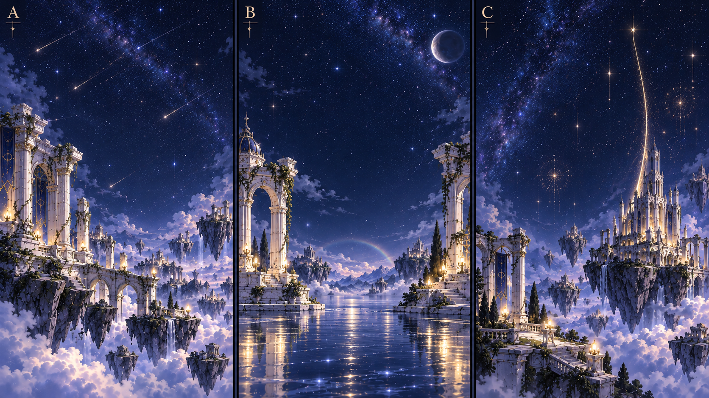

# テーマ付き6面セットの拡張方針

2026-10-18。発案者が構成案へ合意し、続いて本体の実装を依頼した。**0.64.0で直近の18面と採用音程・背景を実装した。** 最新の対応は[実装対応](#10-0640の実装対応)、検証・公開の現在地は[点検](reviews/2026-10-18-themed-sets-bell-pitches.md)を参照。以下の構想・当時の未実装表記は後続の対応表で補う。新アイテム・周期開閉・19面以降は構想のまま。

## 1. 合意した進め方

- 6面を一つのテーマとして継続的に増やす。テーマには、達成目的・考える工夫・背景のまとまりを持たせる。18面や24面を総数上限にしない。
- 直近は既存の星・プリズム・鐘・配線で内容を深める。新しいアイテムを投入するのはもう少し先とする。
- 今の7〜12面は内容・難易度を整理し、表示する番号を振り直してよい。お試し1〜6面を基礎として残す。
- 新しい仕掛けは段階的に導入し、単独で慣れたあと、既存の分岐・合流・待ち時間・複数の鐘などと組み合わせる。
- 早い道を順につなぐだけでなく、複数候補から予想・実行・比較・つなぎ直しで解法を見つける遊びを継承する。通信ネットワークの経路設計、共有する道、混雑による待ち時間への気づきにもつなげる。
- 見た目が単純でも、プリズムの渋滞を上手く使わないと達成できない課題を含める。読みづらさ、精密な指操作、単なる物量を難しさにしない。

## 2. セット構成

以下の構成で進める。面番号は再編の目安で、旧課題との個別対応、具体的な回路・秒数・本数制限は未確定。

| 対象 | テーマ | 主な工夫 | 状態 |
|---|---|---|---|
| 1〜6面 | お試し | 基本の結線、時間、故障、到着間隔 | 現行を基礎として保持 |
| 7〜12面 | すべての鐘へ届ける | 分岐位置、道の共有、本数制限、最後の鐘までの速さ | 既存を材料に再編する方針に合意。未実装 |
| 13〜18面 | ひとつの鐘で、響く間隔をつくる | 経路の時間差、合流、渋滞の活用 | 下記6面案の方向に合意。未実装・未検証 |
| 19〜24面の候補 | すべての鐘を、時間差で鳴らす | 全鐘への到達と、鐘が鳴る時刻の組合せ | 後続セット候補。実装時期・個別条件は未定 |
| その先 | 鏡など新しい仕掛け | 基本操作の体験から、既存の仕組みとの複合へ | 後続構想。投入する番号・順序は未定 |

現行Q7・Q8はすべての鐘への到達、Q9〜Q12は一つの鐘への間隔・回数を扱う。Q11・Q12には合流待ちがある。これらを再利用・改訂するが、どの旧課題をどの番号へ対応させるかは、作問と難易度確認後に決める。

「すべての鐘を時間差で鳴らす」は現行の全鐘到達条件だけでは表せない。鐘の順番、各鐘の初回到達を比べるのか、各鐘へ複数回届けるのか、間隔と回数の扱いは後続で具体化する。新しいパーツの追加とは分けて、条件判定も設計・検証する。

## 3. 13〜18面の方向

名称は仮題。必要な秒数・処理時間・到達回数・配線上限・満点基準は作問時に成立を確認して決める。現時点で、全案が現行回路のまま成立するという検証はしていない。

| 面 | 仮題 | 狙い |
|---|---|---|
| 13 | ふたつの光、ふたつの時刻 | 分岐した光の経路を選び、間隔をつくる |
| 14 | 三つの流れ星 | 3回の到達を等間隔にそろえる |
| 15 | 追いついた光 | 近い時刻に合流させ、渋滞で間隔をつくる。単純な外見でも待ち時間の利用が必要 |
| 16 | 急ぐ光、待つ光 | 待たせる光と迂回させる光を選ぶ |
| 17 | 待ち合わせの先へ | 分岐と合流を組み合わせ、到達順を整える |
| 18 | 静かな四重奏 | 本数制限の中で4回の響きを組み立てる |

渋滞を避けるだけでなく、狙った時間差を作る仕掛けとして使う。例として、処理に1秒かかるプリズムへ2.0秒・2.4秒に光が到着すると、後続は処理待ちになり、出発は3.0秒・4.0秒となる。同じ0.5秒の道で鐘へ進めば、到達は3.5秒・4.5秒で1秒間隔になる。この例は考え方の説明で、採用ステージの数値や検証済み回路ではない。

各セットの前半は主な仕組みを読み取りやすく示し、後半は複数の工夫を組み合わせる。プリズム数や到達数だけを難易度の指標にせず、比較する経路、分岐・合流の段数、待ち時間の影響、選べる余地で調整する。難易度の最終判断には試遊を含める。

## 4. 後続の新キャラ・パーツの構想

ここでのキャラには、星・プリズム・鐘のような盤面のパーツも含む。新しい人型の案内役を追加する決定ではない。

| 題材 | 今回記録する方向 | 具体化が必要なこと |
|---|---|---|
| 鏡 | 固定位置の鏡の向きを変え、光をプリズムや鐘へ導く。角度は大まかでよく、精密な照準は要求しない | 向きの操作・許容範囲、入射と反射の対応、結線との関係、処理・保存・採点への接続 |
| 鏡のプレビュー | 操作中に反射先を確認する。淡い虹色の光、対象へ近づくと吸い付く表示は具体化案 | プレビューと確定の区別、指による遮蔽、端末ごとの操作。指を離す確定方式等は試作で調整 |
| ロケット | 後続の追加題材として保持し、世界観に合う役割から具体化する | ゲーム内の役割・操作・見た目・SE・背景・導入順のすべて |
| 花火 | 後続の追加題材として保持する | 仕掛けとしての役割。現行の満点クリア演出の花火と同じ機能と決めつけない |
| 流れ星・虹 | 舞台や光の表現、セットの題材として保持する | 固有のゲームルールを持つか、背景・演出の題材として使うか |

鏡・ロケット・花火を同時に投入する方針ではない。それぞれの役割が分かる導入を用意してから、既存要素・後続要素との組合せを増やす。投入順と面数は未確定。

## 5. キャラ・SE・背景をまとめて準備する

新しいキャラを導入する際は、課題や動作だけでなく、次の制作・確認を一つのまとまりとして扱う。

| 準備するもの | 内容 |
|---|---|
| 役割と操作 | 何をするパーツか、触れる場所、選択・操作中・確定・取消を定義する |
| キャラ画像と状態表現 | 今の採用画像に合う造形と質感。通常・選択・候補・動作時など、そのパーツに必要な状態を用意する |
| SE（操作や到達を知らせる短い音） | 新しい役割に合う音を準備し、必要に応じて候補を試聴・選定する。発音する操作・到達等のタイミングを定義する |
| テーマ背景 | セットの題材に合う背景を用意する。パーツと配線・秒数の読み取り、縦横・PC・スマホの構図を確認する |
| 説明と練習 | プレイヤー向けの名前・パーツ説明・遊び方と、導入課題や練習をそろえる |
| 適用と確認 | 計算・保存・採点・記録との接続、停止・消音・表示設定、負荷・通信なしでの使用を確認する |

既存パーツだけのセットでも専用背景を検討する。セットごとに6枚の別背景を必須とする決定ではなく、基本背景と構図の変化など、必要な量を決める。新キャラを加えない段階で、採用済みの鐘・SE・ジングルを一括差し替える決定でもない。

音は現行の2オペレーターFM音源との整合を軸にする。採用済みの鐘・プリズム到達R2・操作T2・結線W2・通常クリアC1・未達成N2・満点F4と残響を保持し、新SEは役割に応じて準備する。共通音量・停止・消音・結果音の重なり対策と、30msの初期値・利用者の遅延調整も維持する。音の余韻やプレビューを計算・到達・採点の時間へ加えない。

## 6. 世界観と背景の方向

今の深い青の星空、白い石造り、淡い金色、静謐さを継承する。題材に合わせた光や空の現象を加えても、既存の採用キャラと同じ世界に見えることを優先する。背景は美しさと盤面の読み取りを両立し、中央の配線・秒数・対象物の操作領域を確保する。

先の比較画像は方向を探るための資料。**A・B・Cのいずれも今回の回答だけで採用確定とはしない。** Bを鏡の題材に勧めた経緯はあるが、鏡は後続へ送るため直近セットへの割当ても未定。

画像は既存の遺跡・天文台PNGを参照してimagegenで作成した概念画。実際の盤面を重ねた見やすさ、縦横の切り抜き、端末の表示・負荷は未検証。背景の採用画像、セット名、キャラ画像、SEの具体的な音色は後続でそろえて選ぶ。

## 7. 後続作業と保持する条件

| 作業 | 状態・完了条件 |
|---|---|
| SET-01：7〜18面の再編・作問 | 未実装。旧課題との対応、回路・候補・本数・時間・難易度を具体化する |
| SET-02：成立と出題の確認 | 未実施。全配線の検査、手計算との照合、満点の一意性と別配線での部分点、動作上限を確認する |
| SET-03：セット背景・導線 | 未制作。背景の採用、一覧・連続プレイ・説明でのまとまりを確認する |
| SET-04：複数鐘の時間差・到達順 | 後続候補。全鐘到達＋指定順、間隔・回数と採点を具体化する。音程・和音の試聴WAVのみ試作済みで、課題とアプリへの音程適用は未実装 |
| SET-05：新キャラと複合セット | 後続構想。役割・操作・画像・SE・背景・説明をまとめて準備し、導入から複合へ進める |
| SET-06：周期的に開閉するプリズム | さらに後の高難度構想。送出タイミング、周期の基準、OFF中の扱い、満点条件を具体化する |

既存の満点配線1通り・部分点クリア・選び直し時の出題変更と再挑戦時の保持を、改訂課題でも作問・検証の条件にする。成立が難しい場合は技術上の問題を報告し、未検証のまま採用や検証範囲からの除外をしない。

表示番号を振り直しても、旧成績・元の出題条件・保存回路・全記録を残す。旧番号の点数を別の新課題の成績として付け替えない。変更した課題の内容版・識別と表示順の対応を設計する。最短経路の計算と、分岐・複製・合流待ちの動作は区別し、既存規則の変更を新しい背景や演出へ混ぜない。

PCとスマホの見やすさ・操作、計算の成立、体感難易度、実際の音は別に確認する。対象環境は維持し、PCの検査だけで実機合格としない。アプリ更新時は表示版・キャッシュバスター・追加資材をそろえる。今回は資料のみの更新で、アプリの版・公開内容は変更しない。

## 8. さらに後の構想：営業時間のような周期的なON／OFF

今回の記録作業中、発案者から「最初の構想にあった営業時間のような要素」「一定時間ごとにプリズムがON／OFFし、タイミングを見て『鐘を鳴らす』を押さないと100点にならない」という案が出た。難易度がかなり上がるため、**まだまだ後で考える題材**として保持する。7〜18面へ混ぜて実装する指示ではない。

続けて発案者は、OFF中に光が待たされる方式なら「100点にならないだけでクリアはできるので、その方が易しい」と評価し、「最終的には見た目の面白さで決めましょう」と指定した。**OFF中は光を待たせ、周期による追加待機で満点と差を付ける方式を中心案とする。最終採用は、待機から再び進む光の表現などを試作・比較して決める。** 今回この方式や採点式を最終確定したとは扱わない。

さらに、複数方向へ進む光の中に常時ONのプリズムと周期的にON／OFFするプリズムを混在させ、一部は進み、一部は待つ動きでもクリアが成立して満点とは差が付く案が出た。発案者は続けて「そんなにシビアにしたくない」と指定した。**開始の一瞬を厳密に狙う遊びにせず、ONの時間と満点を取れる開始時機に十分な幅を持たせ、見て大まかに判断して押せる操作感を目指す。** 具体的な周期・時間幅・許容方法は未確定。

[元の要件定義書](../要件定義書_音の庭.md)にも「営業時間等を制限時間の表現に使う案」があり、採用・制限する対象は未決とされている。今回の周期開閉は具体化の新しい候補であり、旧資料の候補がすでに実装済みだった、または同じ意味で確定していたとは扱わない。現行の一つの処理ゲートによる順番待ちとは別の追加ルールになる。

### 面白さの核

- 配線を考えることに加え、開くタイミングと光の移動時間を読み、送り出す時機を選ぶ。
- 同じ配線でも、到着時に開いているかによって待ち時間等が変わり、開始のタイミングが満点条件に関わる。
- 中心案では、OFF中に光が来ても待たせて次のONで進め、タイミングを外しただけで即失敗にしない。ほかの条件を満たせばクリアでき、満点を狙う再挑戦につなげる。
- 常時ONの経路と周期的に開閉する経路を混在させ、先へ進む光と待つ光の違いが盤面で分かるものにする。一部の経路が待つ構成でも、必要な到達を満たせばクリアできる条件を検討する。
- 広いON時間、分かりやすい予告、満点になる開始時機の幅を作り、多少開始がずれても同じ良い結果を得られるようにする。複数の周期がごく短い一瞬だけそろう設定や、ミリ秒単位の目押しを課題の難しさにしない。
- 基本の開閉を理解する導入を用意し、その後、異なる周期・経路・分岐・渋滞などを段階的に組み合わせる。組合せや6面セットの配置は未確定。

### 後続で設計すること

| 論点 | 記録する注意・未決事項 |
|---|---|
| 開始前の周期 | 押すたびに同じ周期の先頭へ戻すだけでは、押すタイミングを選ぶ意味が生まれない。開始前から見える周期と、実行開始の時点の関係を設計する。端末の時刻を無条件に使うという決定ではない |
| OFF中に届いた光 | 次のONまで待つ方式を中心案とする。通過できず終了する方式は中心案とせず、最終採用は見た目の面白さを比較して決める。処理途中でOFFになった場合や、待ち列との関係は未決 |
| 100点とクリア | 中心案では周期のOFFによる追加待機があってもクリアでき、満点と差を付ける。満点の開始時機は一点に絞らず十分な幅を持たせる。必要な待ち時間を使う既存の渋滞課題まで一律に減点する変更ではない。既存の指定間隔・回数の厳密な達成判定を自動で緩める意味でもない。この追加テーマのクリア条件・満点基準・減点式・再試行を分けて具体化する |
| 分かる表示 | ON／OFF・次に開く時機が音なしでも読める表現、必要な予告や説明を検討する。常時ONと開閉するものの区別、進む光と待つ光の見え方も比較する。大まかに見て押せるようにし、精密タップや反射神経だけの難しさにしない |
| 時計と公平性 | ボタン押下、約0.25秒の開始演出、実際の送出のどこを基準にするかを決める。音声の遅れや端末の描画負荷を採点差にしない。開始演出を既存の実行時間へ加算する変更とは分ける |
| 記録と再現 | 周期・ONの長さ・開始時に周期のどこだったかを再現できる条件、停止・再開・非表示・再挑戦の扱いを設計する。既存の成績・保存・全記録を保持する |
| 素材と確認 | パーツの開閉、光が待つ様子と再び進む様子、必要なSE、テーマ背景、説明・導入課題をそろえる。発案者は最終的に見た目の面白さで選ぶ方針。既存音・演出設定・遅延調整を尊重し、各対象端末で表示・操作・音を確認する |

数値・採点式・許容幅・OFF中の待機方式の最終採用・採用時期は今回確定しない。時間に応じて通過条件が変わるため、現行の経路計算・将来到達の判定・終了上限との整合を後続で検証する。成立確認が難しくても、勝手に候補や検証対象から外さない。

## 9. 後続候補：複数の鐘の到達順と、チャイム・和音の響き

発案者から「すべての鐘への到達に加えて、A→B→Cの順に鳴らす」「鐘ごとに音程を変え、メジャートライアドの音程にする」という案が出た。続けて「短いスパンで到達させると和音にできる」と着想が加わった。複数鐘の時間差のセット等へ組み合わせる後続候補として記録する。採用する面番号・音域・具体的な時刻と採点は未確定で、今回のアプリには追加しない。

さらに発案者から、2音ならドアチャイムのような音程と間隔もよいとの提案があった。2つの鐘の到達順・時間差でチャイム風の響きを作り、3つの鐘ではメジャートライアドの音の並び・和音を楽しむ方向を候補に加える。2音の具体的な高さの関係と間隔も試聴して選び、今回数値を固定しない。

2026-10-18、発案者の「先に聞きたい、wavでもよいので試作」の依頼により、[試聴資料v0.1.0](../設計検証/鐘の音程試作-20261018/README.md)と[プレイヤー](../設計検証/鐘の音程試作-20261018/index.html)を作成した。D1はミ→ドの0.5秒差、H1はド→ミ→ソの0.12秒差、H2は同じ3音の同時発音。採用済みの鐘の合成処理を使い、試作内で基音とアタックの音程をそろえて変える。音割れ・終了・PCMとWAV形式、Chrome／Edge／Windows WebKitのプレイヤー再生など13項目を確認。人の聴感・物理端末の確認と採用判断は未完了。アプリの音・版・資材は変更していない。

同日、発案者からドアチャイムを1オクターブ上げる依頼と、前回の3和音は倍音の関係で濁るとの聴感の指摘を受けた。続いて「C→G→上のC」「C→F→A」を約0.25秒ずつずらした2種類の試聴を依頼されたため、[試聴資料v0.2.0](../設計検証/鐘の音程試作-20261018/v0.2.0/README.md)へ追加。D2はミ6→ド6で0.5秒差を保持、H3はC5→G5→C6、H4はC5→F5→A5で各0.25秒差。倍音を整える別音色も担当から提案したが、今回の2種類は指定された音程・間隔の違いを比較するため、倍音の合成設定は現行のままとする。前回のWAVは保持し、音程関係・0.25秒間隔・形式・音割れなし・再生等を確認。新試作の聴感と採用は未確認で、本体は変更しない。

同日、発案者がD2を「OK」と評価したため、2音のドアチャイム案はD2の高さ・間隔を採用する方向として記録する（ゲームへの組込みは未実施）。H3・H4は間隔を空ければ使えそうとの評価と、H3は約1秒差・高い音から下げる案、H4は約0.5秒差、さらに1オクターブ上の試聴依頼を受けた。[試聴資料v0.3.0](../設計検証/鐘の音程試作-20261018/v0.3.0/README.md)ではH3a＝C5→G5→C6、H3b＝逆順を各1秒差、H3c・H3d＝それぞれ1オクターブ上、H4a＝C5→F5→A5を0.5秒差、H4b＝その1オクターブ上の計6種類を用意した。音色・余韻・共通音量は保持。音程・間隔・旧WAV保持・音割れなし・再生等17項目を確認。今回の6種類の聴感と採用は回答待ちで、アプリ本体は変更していない。

### 試聴後の採用方針（2026-10-18）

発案者がD2に続いてH3a・H3b・H4aを「OK」と評価した。採用する音の並びは、D2＝E6→C6（0.5秒差）、H3a＝C5→G5→C6（試聴は1秒差）、H3b＝C6→G5→C5（試聴は1秒差）、H4a＝C5→F5→A5（試聴は0.5秒差）。上のオクターブのH3c・H3d・H4bは今回の採用に含めない。

- 発案者の聴感では、間隔が0.5秒以上なら違和感はない。異なる音程を続けて鳴らす際は、0.5秒以上を目安に作問・音程を割り当てる。H3の間隔を必ず1秒へ固定する合意ではない。
- 0.5秒未満で続けて届く場合は、できるだけ同じ音程にそろえる。これは響きを整える努力目標であり、必須の達成条件や実装の完了条件にはしない。例外を許し、既存課題の到達時刻・配線の選択肢・採点を音のために変えない。
- 課題ごとの音程割当を基本に調整し、プレイ中の到達に合わせて音程を自動変更するか等の具体的な方式は今回確定しない。未確認の配線すべてで濁らないという検証結果へ広げない。

この選定時点ではゲームへの複数音程の組込みは未実装だった。その後の本体実装指示に基づき、0.64.0で全鐘到達セットへ適用した（第10節）。

### 課題と響きの方向

- すべての鐘へ届けることに加え、指定した鐘の順番で到達する条件を検討する。A・B・Cは発案者の例示で、表示名を今すぐ変更する決定ではない。
- 導入では「すべてへ届ける」、その後「指定順に届ける」、さらに「順番と時間差を組み合わせる」と段階を付ける案とする。順番だけの課題へ、指定間隔の条件を自動的に付けない。
- 3つの鐘の音程は上記の採用済みの並びを軸にする。当初例示したド・ミ・ソは試聴で濁りの指摘があり、採用済みと扱わない。各課題の鐘との対応は後続で具体化する。
- 採用済みの鐘の音色を土台に高さを変える方向とし、好評だった鐘の質感を保つ。音程変更時のアタックと余韻の調整は試聴で確認する。音色全体の差し替えや、既存課題の全鐘を直ちに異なる高さへ変更する指示ではない。
- 鐘の余韻が残る間に次の鐘へ到達させると、異なる音程が重なる。試聴後は0.5秒以上の間隔を目安に音の並びを楽しむ方向とし、短い間隔で異なる音程を重ねること自体を優先しない。
- 2音は、高低のある音を適度な間隔で順に鳴らすドアチャイム風の響きを検討する。一つの到達で完成した2音の効果音を自動再生する案ではなく、原則として各鐘への到達が1音に対応し、プレイヤーが作った経路の順番・間隔が音の並びになるものを想定する。対応方式は実装時に具体化する。
- 短い時間差でも到達順を保つ構成と、同時到達による和音は区別する。同時到達を内部の固定順で並べただけで「A→B→Cの順を達成」と扱わない。どの到達を比べるか、同時の扱い、追加到達、順序違いの結果・部分点は後続で定義する。

### 公平さ・表現・検証

- 到達順や間隔は計算上の到達時刻で判断し、音の余韻、発音の遅れ、ジングル、描画順で変えない。音なしでも鐘の識別・実際の到達順と時刻を確認できるようにする。
- 発案者の「シビアにしたくない」という方向を継承する。和音が心地よく重なる十分な時間幅を検討し、わずかな開始操作の差やミリ秒単位の一致を面白さの条件にしない。許容幅と判定方法は未確定で、現行の厳密な間隔判定を資料更新だけで緩めない。
- 3音が重なった時の音量・音割れ・響きの濁り、音程による聞き分け、鐘のアタック、結果ジングルとの重なりを試聴する。採用済みの消音・停止・共通音量・遅延調整を保ち、見た目と音の両方で楽しさを確認する。
- 役割・条件の説明、鐘ごとの見分け、到達演出・SE・背景をセットで準備する。数値の成立、採点と保存の整合、対象端末での視認性・実際の音は未検証として残す。

## 10. 0.64.0の実装対応

表示順は難易度の段階を考慮した実装担当の選択。旧課題の回路・版・48出題・成績を保ち、別の課題として点数を付け替えない。新6課題にも各8出題を追加し、実践の計96出題で全配線を確認する。

| 表示番号 | 課題 | 内部ID | 元の内容 | 音程 |
|---|---|---|---|---|
| 1〜6 | お試し | Q1〜Q6 | 固定の6面を保持 | 従来の鐘 |
| 7 | 分かれ道の先に | Q19 | 新作、二鐘への分岐と経路の比較 | D2 |
| 8 | 二つの祭壇へ | Q7 | 旧7面・内容版2を保持 | D2 |
| 9 | 三つの響きを導く | Q8 | 旧8面を保持 | H3a |
| 10 | 分岐を受け継ぐ光 | Q20 | 新作、分岐からさらに分岐 | H3a |
| 11 | 三つの出口を探して | Q21 | 新作、途中の出口と共有経路 | H3b |
| 12 | 響きをつなぐ回廊 | Q22 | 新作、本数制限の中で三鐘へ | H4a |
| 13 | ふたつの光、ふたつの時刻 | Q13 | 新作、複数候補から1秒差の二到達 | 従来の鐘 |
| 14 | 三つの流れ星 | Q14 | 新作、四つの経路から三到達を選ぶ | 従来の鐘 |
| 15 | 合流先の順番待ち | Q11 | 旧11面、渋滞必須の二到達 | 従来の鐘 |
| 16 | 途中で分けて、さらに分ける | Q9 | 旧9面、二段の分岐 | 従来の鐘 |
| 17 | 三つの光、ひとつの合流点 | Q12 | 旧12面、渋滞を含む三到達 | 従来の鐘 |
| 18 | 四つの光を一秒ずつ | Q10 | 旧10面、分岐を重ねた四到達 | 従来の鐘 |

7〜12は「すべての鐘へ」・背景「星渡りの回廊」、13〜18は「響く間隔をつくる」・背景「月映りの水殿」。一覧はテーマの境界でページを分け、小画面では同じテーマをさらに分割してスクロールを避ける。連続プレイはこの表示順で進み、18面の次は一覧へ戻る。

複数鐘の音程は鐘の識別順に割り当て、実際の配線による到達順・時間差で鳴らす。0.5秒未満の連続到達は前の高さに寄せる努力目標を音の表示処理だけに実装。到達を遅らせたり、既存の厳密な時間判定を緩めたりしない。単独鐘と自由作成の音は保持する。

SET-01は上記の18面構成を実装。SET-02は全96出題の成立確認と旧48出題の一致確認、SET-03は今回の背景・一覧・連続進行を実装。SET-04は音程の適用部分までで、指定順や複数鐘の時間差を達成条件にする部分は後続。SET-05・06は構想のまま。難易度の体感とスマホ実機の視認性・聴感は別途確認する。
