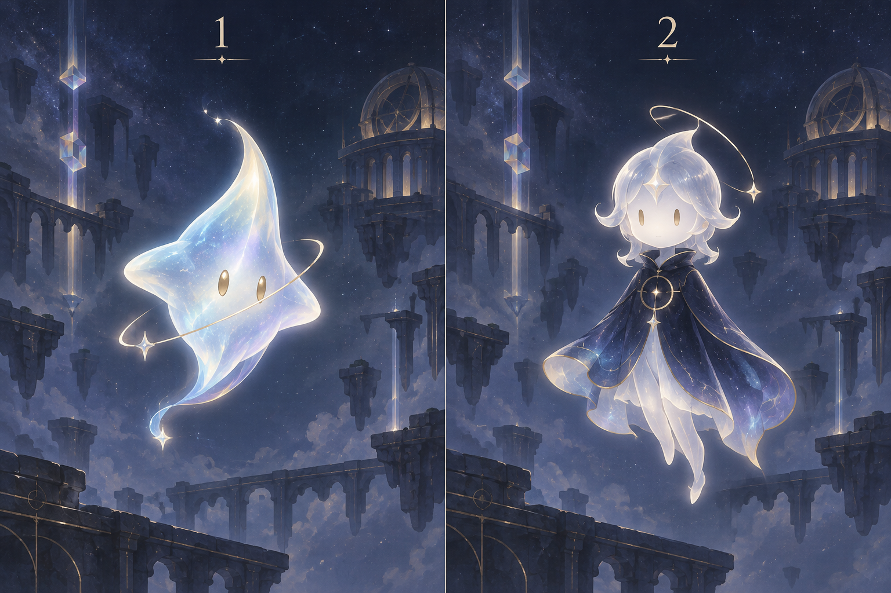

# プリズム・ノーツ：世界観と表現の設計

| 項目 | 内容 |
|---|---|
| 版・日付 | v0.5 / 2026-10-12 |
| 発案者の指定 | 名称、静謐な世界観、舞台、プリズム、星の光線、祭壇のチャイムと星座の演出。SD-037 |
| 後続の合意 | 案内時だけ現れる星の精霊SD-038、遺跡にQ1～3・天文台にQ4～6の舞台振り分けSD-039、共有ロゴの採用SD-040 |
| 未決 | 精霊の姿・名前、出発点の姿、造形、ステージの具体的な配置・数値、画面全体の配色・日本語書体、音と演出の細部 |
| 前提 | 初期の課題6問・自由の見本2つ、元の24機能と後続追加F-025・026を合わせた全26機能、既合意の計算・記録・操作を維持。スクロールを避ける要求SD-036を画面案で検討する |
| 検証状態 | 設計相談中。アプリ・描画・発音・スマホでの収まりは未検証 |

## 1. 指定された世界観

名称は「プリズム・ノーツ」。星の光をプリズム型の中継器を通して祭壇まで導く、美しく静謐な世界観。舞台の題材は夜空に浮かぶ遺跡や巨大なドーム型の天文台。

中継点はプリズム、パケットは「星の光線」、到着先は祭壇にあるチャイム。光が到達すると、ウエストミンスターの鐘のような音が鳴り、周囲の星座が浮かび上がる。具体的な音程・フレーズの長さ・音量・同時到着の発音や星座の表示時間は未決。

旧資料名の「音の庭」は以前の仮称。ファイル名と履歴を保存し、新しい資料はこの名称と表現方針を参照する。旧資料の「庭」は配置領域を指す説明として読み、庭の世界観への合意にしない。要件定義書v1.5の名称・世界観の未決表記は、後続のSD-037で今回指定された範囲を具体化したものとして読む。以前の音楽工房・通信基地の候補は今回採用されていない。

## 2. 動作と見た目の対応【具体化案・未合意】

| 既存の動作 | 表現の候補 | 保持する条件 |
|---|---|---|
| 出発点から送出 | 星の光を放つ光源 | 初回送出は即時。自由では一つを保ち位置変更できる。戻った光の処理も維持 |
| 道を移動 | 光の先端や明るい区間が道を進む | 「光線」という呼称でも各送出・各到着を区別し、表示した移動時間を守る |
| プリズムで処理 | 内部に光を蓄え、指定時間後に送り出す | 指定処理時間と順番待ちを維持。屈折角度・色による新しい転送条件は追加しない |
| 分岐・循環 | 複数方向への発光、道を巡る光 | 最速方式と広がる方式の違いを維持。見た目のために複製・再来を省略しない |
| 道・プリズムが使用不可 | 道やプリズムを暗くする等 | 音なしでも区別できる形・印を併用する候補。見た目の故障を移動中の新ルールにしない |
| 祭壇へ到着 | チャイムと浮かび上がる星座 | 受信は終点。各到着回数・記録を保持し、演出後に終了した光の絵を消す |

チャイムや星座の余韻を到達時刻・処理時間・採点に加算しない。Q6の指定間隔・総回数は計算上の光の到着で判定し、音が続くことと次の到着を混同しない。短い間隔や同時到着での発音方法はR-09で具体化し、検証対象から外さない。

## 3. ステージと画面

初期6課題は採用済みの内容を維持し、次の舞台への振り分けをSD-039で合意した。全課題を最初から選べる方針を維持する。

| 舞台 | 課題 |
|---|---|
| 夜空に浮かぶ遺跡 | Q1接続の導入、Q2最速経路、Q3時間と道の本数 |
| 巨大なドーム型の天文台 | Q4道の故障、Q5プリズムの故障、Q6到着間隔と総回数 |

背景・点の数・候補の道・本数制限・数値・星座の図案は未決。舞台の振り分けを、課題数の変更・別モードの追加・数値の検証完了にしない。

スマホでは実験エリアと操作領域の広さを両向きで検討する。装飾が点・道・時間・待ち列の読み取りやドラッグを妨げない構成を比較する。SD-042～044で設定項目のボタン切替、スマホの時間手入力中だけ実験エリアを隠す専用表示、記録と削除対象の数件ずつのページ切替を合意。[編集操作案v0.4](基本設計_編集操作案_音の庭.md)を参照。これは後続の各「1」に基づく方式の承認であり、スクロールを避ける検討依頼だけに基づく承認や実機確認済みとは区別する。

## 4. 星の精霊（役割は合意済み、姿は未決）

SD-038の「2」で、小さな「星の精霊」を案内役として採用。初回案内や説明を開いたときに現れ、通常の操作中は表示しない。姿・名前・具体的な表示領域は未決。新しい操作能力を追加した合意ではない。

【未採用の旧候補】人物や顔のあるキャラクターを置かず、プリズム・光・星座の反応と短い文字だけで案内する案は選ばれていない。

【外見の比較候補】小さな画面で輪郭が分かる「光の生き物に近い姿」と、星空の衣をまとった「小さな人型の姿」を比較する。どちらも未合意。生成する概念画は造形の相談用で、実際の画面寸法や縮小時の読み取り・実機での収まりの検証ではない。

2026-10-12、imagegenスキルで比較用の概念画を生成し、二つの異なる輪郭と番号1・2を目視確認した。1は光の生き物、2は星空の衣をまとった人型。背景・色・装飾は画像生成時の比較用の提案であり、今回の画像を見せたことだけで配色・舞台の造形・外見の採用を確定しない。輪郭の単純さから1をおすすめの候補とするが、小さな実画面での読み取りは未検証。制作済みの比較画像と、まだ選ばれていない外見を区別する。

R-06の世界観・要素・キャラクターの役割・舞台の振り分けの相談は一区切りとする。精霊・背景・各要素の外見はR-07、画面に置く位置と案内の表示はR-04、課題の詳細構成・数値と基準値は既存の技術設計・検証へ対応付ける。残作業を除外・検証済みにせず、対応先を明示して続ける。

## 5. 採用ロゴ（SD-040）

共有された濃紺背景に金色のPRISM / NOTESを二段で置く文字ロゴを採用。Montserrat 600/500、96/36px、字間8/22px、段の間隔8pxを基準とし、小さな表示領域では同じ比率で縮小する。[調整版と確認結果](画面案/ロゴ/README.md)を参照。ロゴの配色と英字書体を採用したことで、画面全体の配色・日本語書体・精霊の外見まで採用済みにしない。

単体ロゴはChromium・WebKitで各10サイズ＋書体遅延、合計22件の表示確認を実施した。スマホ実機、他の操作を含むタイトル画面やゲーム全体のスクロールなしは未確認。
