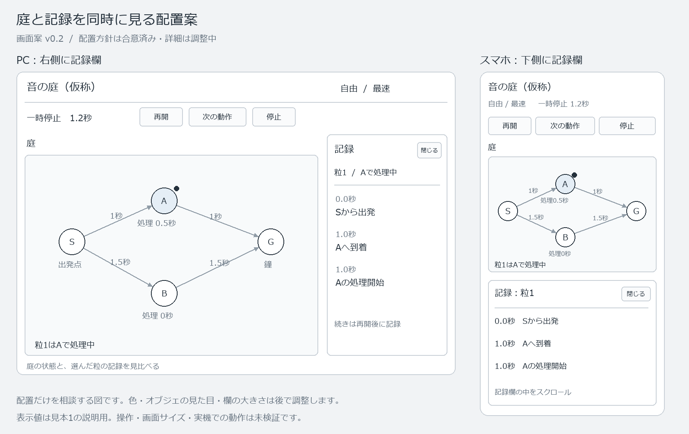
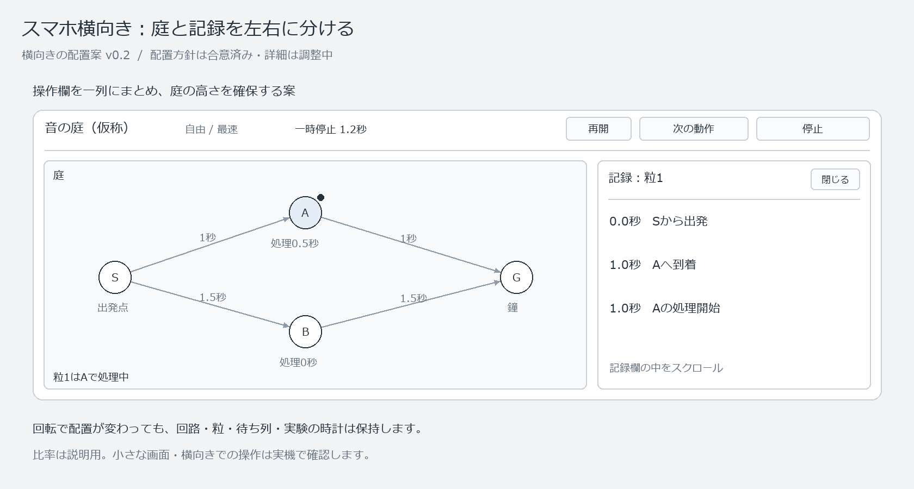

# 音の庭（仮称） 庭と記録の画面配置案

| 項目 | 内容 |
|---|---|
| 版・日付 | v0.4 / 2026-10-12 |
| 状態 | SD-030で縦横両対応と配置方針は合意済み。見た目・寸法・詳細操作は具体化中。基本設計全体の完成版ではない |
| 根拠 | F-007・008・010・020、NF-005、SD-014～017、R-03・10、BD-04・11 |
| 合意済みの前提 | 庭を残した同じ画面で記録を見る。実行中に記録を開くと一時停止し、再開は明示操作 |
| 今回の合意 | 縦横両対応。横長は記録欄を右側、縦長は下側。回転しても回路・粒・待ち列・実験の時計を保持。二案への「1」、SD-030 |
| 未確認 | 実装・実際の操作・小さな画面・横向き・文字拡大・対象端末・音。図での確認を実機確認の代わりにしない |

## 1. 配置の具体案

前のv0.1のスマホ図は縦向きを想定していた。その時点で向きは未決で、縦専用の合意ではなかった。横置きへの質問を受けて縦横両対応と縦専用の二案を示し、発案者の「1」で縦横両対応と以下の配置方針を確定した（SD-030）。

横長のPC・スマホ横向きでは、庭の右側に記録欄を開く。縦長のスマホでは上側に庭、下側に記録欄を表示する。機種名だけで固定せず、利用できる幅・高さに合わせて配置する案。スマホ横向きでは操作欄を一列にまとめて庭の高さを確保する。記録が長い場合は記録欄の中をスクロールし、庭と実行操作は見えるようにする。欄の実際の幅・高さや端末ごとの切り替え条件は画面サイズと操作の確認後に調整する。

図は自由の最速見本で、実験の時計1.2秒に記録を開き、一時停止している説明用の状態。Aへの到着と処理開始は1秒、処理終了は1.5秒なので、終了の記録はまだない。表示に仮の完了記録や実機の測定値を足していない。図の数値は初期コンテンツ案の計算から作ったもの。

### 1.1 スマホ横向きの追加案

横向きの幅と短い高さを使う配置のイメージ。図の比率は説明用であり、特定機種で同じ大きさの文字・操作・8点の見本が収まることを確認した図ではない。ブラウザの操作欄や文字拡大も含め、実際に使える範囲で確認する。実機確認前に最小対応サイズ・切り替え幅を根拠なく確定しない。

【失効：未採用案】縦専用として横向きでは縦へ戻す案内は不採用。縦横両対応への合意は実機での操作・収まりを確認済みとするものではない。

## 2. 動作と保護の前提

- 記録を開くときはSD-016に従い、実験の時計・粒・待ち列を保持する。再開は「再開」から選び、記録を閉じるだけで自動再開しない。
- 回転や欄の開閉で庭の表示領域が変わっても、点の配置データ・接続・粒の位置・計算上の時間を変更しない。表示の縮尺や見える範囲を調整する方式を技術設計で具体化する。
- 記録を閉じたら、その領域も庭に使う案。レイアウトの変化を実験の再実行・停止・新しい条件への変更として扱わない。
- 処理開始前の順番待ち、処理中、到着済みを記録と庭で見比べられるようにする。分岐の親子関係、粒の選択、全到着回数、記録の書き出しは既存の要求を維持し、具体的な表示・操作は続けて設計する。

## 3. 図の範囲と残る確認

この図は記録欄を開いたときの配置案だけを示す。課題一覧、条件設定、編集、保存、故障ケース一覧、結果の全項目、チュートリアルの画面を省いたことで、機能を不採用にしたものではない。これらはR-04・05等と全体の画面設計へ対応付ける。

色・書体・点や鐘の外見・正式な呼び名は今回の選択対象ではない。記号と無彩色を配置の説明に使った。PC・スマホの図の比率は説明用で、実際の端末の収まり・タップしやすさ・庭の拡大縮小・記録のスクロール・操作中断は未検証。

図は[生成用スクリプト](画面案/draw_layout_proposal.py)で作成し、2026-10-12に文字の重なり・欄の配置・図と時刻表の関係を目視確認した。操作可能なアプリやデプロイ済みの画面ではない。

## 4. 表示操作（SD-031で合意済み）

小さな画面では、配置済みの点が多い庭を一度に見渡せない場合がある。点の移動・接続とは別に、表示する範囲の移動と拡大縮小を用意する方針を、「この表示操作で進めてよいですか？」への「OK」で確定した。

- 点本体のドラッグは道をつなぐSD-009、移動用のつまみは点の位置を変えるSD-012のまま。
- 庭の余白のドラッグで、見えている範囲を移動する。PC・タッチの両方に用意する。
- PCでは庭の上でホイール、スマホでは二本指の開閉で拡大縮小する。
- 拡大縮小の「＋」「−」と「全体を表示」の操作も用意し、指の操作だけに依存しない。

表示操作は構成の点の座標・接続・時間を編集する操作ではない。実験中・一時停止中も表示だけを調整できる案。記録欄のスクロールと庭の操作の使い分け、接続中に二本目の指を置く場合、中断・回転、拡大縮小後の文字やつまみの使いやすさは技術設計と実機確認で詰める。操作方式は合意済みだが、実装や実機の確認を済ませたものではない。[編集操作案](基本設計_編集操作案_音の庭.md)に追加・初期値・次の削除案とまとめる。
