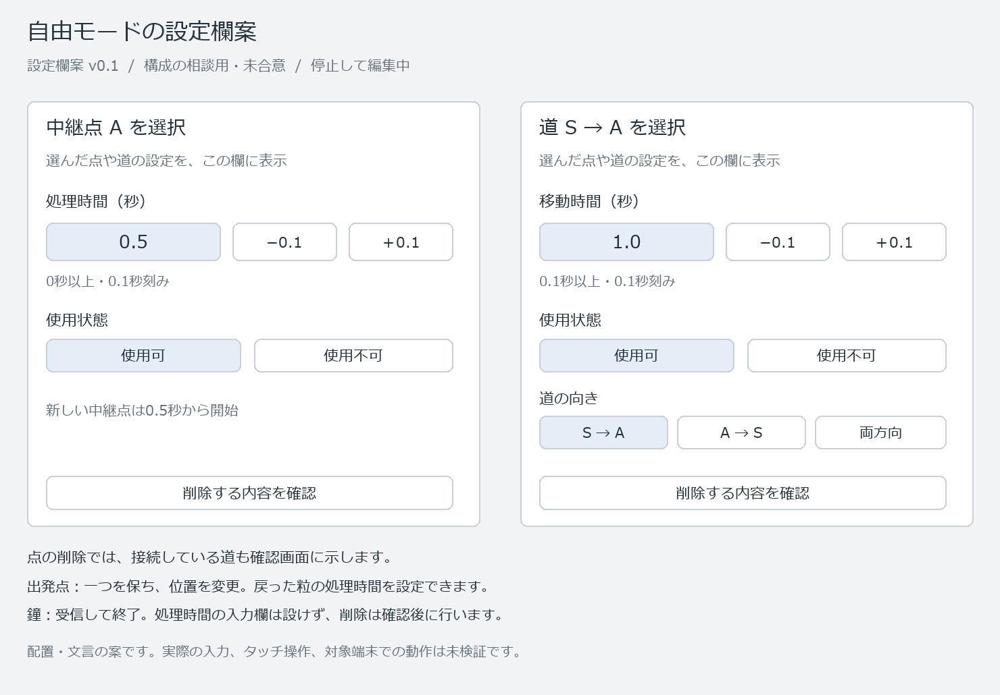

# プリズム・ノーツ 編集操作案

| 項目 | 内容 |
|---|---|
| 版・日付 | v0.5 / 2026-10-12 |
| 合意済み | 表示移動・拡大縮小SD-031、自由の中継点・鐘の追加SD-032、新しい中継点の処理時間0.5秒SD-033、削除確認SD-034、出発点を一つ保つSD-035、設定項目切替SD-042、スマホの手入力専用表示SD-043、記録と削除対象のページ切替SD-044、誤入力修正SD-045、ダブルタップで設定SD-046、設定・記録共用欄SD-047 |
| 継承 | 点本体のドラッグで接続、移動用のつまみで位置変更、新しい道は片方向・1.0秒、時間は手入力と0.1秒増減。SD-007～013 |
| 未合意の具体案 | 細かな寸法・文言、入力途中や操作中断、タップの判定等。方式はSD-042～047で合意 |
| 検証状態 | 操作の設計。アプリ・入力・接続・拡大縮小・描画・実機は未検証 |

### 前提の訂正と今回の依頼

「音の庭」は仮称であり、庭を舞台にする世界観への合意ではない。構想たたき台第2章の庭・石・花等は【想定】、世界観・キャラクターはR-06、これは訂正時点の状態。その後SD-037で名称と世界観、SD-038で案内役、SD-039で舞台の振り分けを合意。残る外見はR-07、画面上の呼び名はR-08に対応する。本書と過去の図の「庭」は、点と道を配置する領域を指していたが、説明上の略称と世界観の採用を混同しない。以後の説明では、この領域を便宜上「実験エリア」と呼ぶ。これは正式名称の決定ではない。既合意の接続・表示操作・記録との配置は維持する。

発案者から「スクロールが発生しないようにしたいので、検討お願いします」と依頼を受領。前に示した「収まらない設定項目だけ欄内でスクロールする」案を採用済みとして扱わず、スクロールを避ける方式を検討する。後続のSD-042～044で設定切替・スマホ手入力専用表示・一覧のページ切替を合意した。寸法と実機での成立は未確認。世界観・各ステージの詳細な構成・キャラクターの役割を決める前に、画面寸法や装飾を最終固定しない。

## 1. 庭の表示操作（SD-031）

| 目的 | PC | タッチ端末 |
|---|---|---|
| 見える範囲を移動 | 庭の余白をドラッグ | 庭の余白をドラッグ |
| 拡大縮小 | 庭の上でホイール | 二本指を開く・閉じる |
| ボタンから操作 | 「＋」「−」「全体を表示」 | 同じ三つの操作 |

点本体のドラッグは接続、つまみのドラッグは点の配置を変更する既合意を維持する。表示する範囲の移動・拡大縮小と、構成の座標・接続・時間の編集を分ける。

【技術設計案】表示だけの操作は停止・実行・一時停止中にも使えるよう具体化する。記録のページ切替を実験エリアの拡大縮小へ誤適用しない。接続途中の二本目の指、表示移動とタップの区別、中断・回転、点とつまみの操作領域は、具体的な画面と端末で照合する。拡大率・移動範囲・文字と操作領域の大きさは未検証。

## 2. 自由の点の追加（SD-032）

停止・編集中に「中継点を追加」または「鐘を追加」を選び、庭の置きたい位置をクリック／タップして一つ置く。配置後は通常の操作へ戻る。部品一覧からドラッグする案は不採用。

【技術設計案】追加待ちのときは置こうとしている種類と取り消す操作を示し、配置されたことが分かる表示にする。追加待ちを通常の接続・位置変更・表示移動と混同しない。取消・別の種類への変更・開始操作・回転が重なった場合の扱いは、入力状態の設計と画面で具体化する。

課題の点や時間はお題が用意する前提を維持する。この追加操作を、課題へ自由に点を増やしたり時間を変更したりする許可へ広げない。

## 3. 新しい中継点の処理時間（SD-033）

自由モードで新しく追加した中継点は、処理時間0.5秒から始める。ユーザーの「0.5sec」に基づく。1.0秒・0秒の二案を示したが、いずれも今回の初期値として選ばれていない。

後で手入力・0.1秒増減で変更でき、0秒を許容する既合意を維持する。読み込んだ構成・見本の設定値・既存の中継点を0.5秒へ書き換えない。道は引き続き毎回1.0秒を初期値とする。

## 4. 削除と確認（SD-034で合意済み）

道は二つの点を端に持つので、点だけを消すと、その点を端にする道も取り除く必要がある。次の手順を、発案者の「1」で確定した。

1. 停止・編集中に、中継点・鐘・道を選び、設定欄から「削除」を選ぶ。
2. 削除する対象と、一緒に消える道を示す。対象を見分けられるよう庭でも強調する。
3. 「削除する」または「取り消す」を選ぶ。実際に消すのは確認後。

| 選んだ対象の例 | 確認で示す内容 |
|---|---|
| 最速見本の中継点A | 「中継点Aと、接続している道2本（S→A、A→G）を削除」 |
| 道S→Aだけ | 「道S→Aを削除」。AやA→Gまで消さない |
| 接続のない中継点 | その中継点だけを削除 |

同じ二点の複数の道や使用不可の道も、削除する点へ接続していれば対象へ含める。両方向の一本の道は一本と数え、複数の別の道と混同しない。接続中は点の削除を禁止して、先に道を一本ずつ消させる案は不採用。削除は確認後とする。

対象は編集中の構成。削除後の自動保存や、保存枠の無断更新は追加しない。保存・ファイル読込の保護は従来の要求を維持する。元に戻す機能の採用をこの手順への合意から推定しない。

最後の鐘を消した編集状態での実行受付、選択・設定欄、確認表示・入力エラー・未完了の操作の処理は全体の編集状態の設計で続けて照合する。削除の方式の合意を、実装・実機の確認済みとしない。

## 5. 出発点（SD-035で合意済み）

自由モードの出発点は常に一つ置き、つまみで位置を変更できる。追加・削除は行わない。削除後に再追加する案は、二案のおすすめ1への「OK」で不採用とした。

初回送出は即時で、戻った粒は処理・順番待ちを受けるD-048を維持する。戻った粒の処理時間は自由では設定できる。新しい中継点の初期値0.5秒を、出発点の再来処理の初期値まで合意済みとして広げない。出発点の初期値の具体化は残る。

## 6. 設定欄の項目と方式（SD-042で合意、詳細は具体化中）

庭で点・道を選ぶと、同じ設定欄にその対象の設定を表示する案。PC・スマホ横向きでは右側、縦向きでは下側の欄を使い、庭を残す。選択と設定表示はSD-046、記録欄との切替はSD-047に従う。対象に不要な設定を出さず、実行・一時停止中に実験条件を変更しない前提を維持する。

| 対象 | 設定する項目 | 削除 |
|---|---|---|
| 道 | 移動時間、向き（正方向・逆方向・両方向）、使用可否 | 対象を確認後に削除 |
| 中継点 | 処理時間、使用可否 | 接続している道も示し、確認後に削除 |
| 出発点 | 戻った粒の処理時間。初回送出には加えない | 追加・削除なし。つまみで位置を変更 |
| 鐘 | 受信の終点として扱い、処理時間を設定しない | 接続している道も示し、確認後に削除 |

手入力と0.1秒増減、入力欄へ移った時の全選択は既合意をそのまま表示する。停止・編集中だけ条件を変更し、実行・一時停止中は条件を固定する。読み取りと表示操作を編集と混同しない。

【合意と残る具体化】スマホの手入力専用表示には確定・取消を用意する（SD-043）。SD-045で不正な値の確定時には入力を残し、理由を入力欄の近くに示して修正を続ける方式を合意。値が正しくなるまで確定しない。取消は変更前の値へ戻す。別の警告を閉じる操作は増やさない。操作数を減らす方針で、対応端末ではキーボードの完了キーでも確定できるよう具体化・検証する。入力欄から移動した場合やキーボードだけを閉じた場合の扱いは未決。空欄・文字・下限未満・0.1秒刻みに合わない値は理由を示して修正を促し、値を黙って丸めない。入力途中の文字列を実験条件へ適用せず、未確定・不正な値を残したまま実行しない。内部の正確な数値の扱い・貼り付け・全角入力・上限・端末での全選択と入力は未検証。

図は設定欄に置く項目の比較用で、完成した画面の寸法や色の確定ではない。対象ごとの項目は既合意・D-048等に対応付けた。2026-10-12に文字と枠の配置を目視確認した。クリック・入力・削除が動くアプリではない。

## 7. スクロールを避ける方式（SD-042～044で合意）

全項目を一度に並べると、スマホの短い高さでは実験エリアか操作領域を圧迫する。文字やボタンを一律に縮める代わりに、設定項目を切り替える案を中心に検討する。v0.1の図は項目の比較に使い、スマホでの収まりの証拠にはしない。

| 場面 | 合意した表示 | 残る設計・確認 |
|---|---|---|
| 縦向き・通常編集 | 上に実験エリア、下に設定欄。「時間」「向き」「使用状態」のボタンで必要な項目だけ切り替える。対象名と、削除できる対象の削除ボタンは常時表示 | 対象ごとの項目は第6章。出発点に削除を追加しない。固定の寸法・正式文言は未決 |
| 横向き・通常編集 | 左に実験エリア、右に同じ切替式の設定欄 | 縦横で機能を減らさない。操作領域と文字の寸法は未確認 |
| スマホで時間を手入力 | 入力中だけ実験エリアを隠し、対象名・入力欄・確定・取消を中心に表示。終了後は元の配置へ戻す | 入力欄に移る時の全選択を維持。±0.1秒の操作では切り替えない。キーボードを閉じただけの場合、回転や中断の扱いは未決 |
| 長い記録や削除対象の確認 | 実験エリアを残し、数件ずつ表示。「前へ」「次へ」と全件中の表示位置でページを切り替える。選んだ記録の詳細は同じ欄で切り替える | 件数は使える広さに合わせる。全記録・削除対象を辿れ、表示の都合で捨てない。詳細の長文・ページサイズ変更時の位置保持等は具体化中 |

SD-042は設定切替、SD-043はスマホの手入力専用表示、SD-044は記録と削除対象の一覧を数件ずつ辿る方式。それぞれ提示したおすすめ1への「1」で合意した。SD-036の検討依頼だけを方式の承認に使っていない。通常編集・記録閲覧では実験エリアを残し、スマホの手入力中だけ一時的に隠す例外を明示する。

全項目を同時に表示する旧図は項目の参考であり、切替方式の実装画面ではない。一項目ずつ前後に送る設定案、入力中も実験エリアを残すスマホ案、一件ずつ送る一覧案は不採用。保存一覧や故障ケース一覧など、今回提示していない一覧までSD-044への合意を広げない。自由モードの表示移動・拡大縮小は、ページや欄のスクロールとは区別する。

確認対象は通常編集、接続、点の配置、設定切替、数値入力と不正値、キーボード表示、削除確認、記録閲覧、回転、文字拡大、ブラウザの操作欄による表示範囲の変化。対象端末の利用可能な幅・高さは未測定であり、最小対応寸法や「全端末で収まる」を根拠なく確定しない。難しい条件も検証範囲から外さず、成立しない場合は該当条件と必要な変更を相談する。

## 8. 対象選択と共用欄（SD-046・047）

| 操作 | 合意した動作 |
|---|---|
| 一回タップ | 対象を選択。起点なら接続候補をフラッシュ |
| ダブルタップ／PCのダブルクリック | 対象の設定を共用欄に開く |
| プリズムからドラッグ | 候補をフラッシュさせて接続 |
| 移動用つまみのドラッグ | 点の位置を変更 |
| 設定・記録の切替ボタン | 同じ欄で切り替え、記録のページ位置を保持 |

通常は実験エリアを残し、設定と記録を常時並べない。手入力専用表示SD-043だけは一時的に実験エリアを隠す。記録を開く操作で一時停止し、閉じる・設定へ切り替えるだけでは自動再開しない。対象を選んだときは「ダブルタップで設定」などの短い案内を出し、PCの文言は操作に合わせる。

【技術設計案・未検証】一回タップの選択を反応させつつ、二回目がダブルタップか接続ドラッグかを区別する。移動用つまみの操作を本体の接続や設定表示へ誤適用しない。対象変更、画面回転、指が増える場合や途中で離す場合は状態の設計を続ける。ブラウザの拡大操作との混同は実機で確認し、既合意の二本指の拡大縮小を維持する。実行・一時停止中の欄は条件を変更しない表示として具体化する。

## 9. 更新履歴

| 版 | 日付 | 内容 |
|---|---|---|
| 0.4 | 2026-10-12 | SD-042～044の設定切替・スマホ手入力専用表示・記録と削除対象のページ切替をまとめて反映。旧図は項目の参考として保持。入力例外・操作中断・寸法・実機は未決／未確認 |
| 0.5 | 2026-10-12 | SD-045～047の誤入力修正・少操作、ダブルタップで設定表示、設定・記録の共用欄をまとめて反映。入力途中・操作中断・タップ判定・詳細寸法・実機は継続 |
