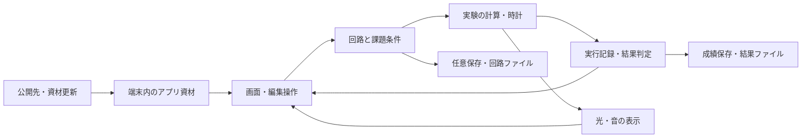

# プリズム・ノーツ 基本設計サマリ

ドラフト v0.1 / 2026-10-12。要件定義書v1.9、基本設計の相談記録v0.27（SD-001～060）に基づく。既合意を組み立てた設計案であり、基本設計全体の承認・実装着手・公開の指示とは区別する。

## 1. 今回まとめる範囲

実装前に必要なのは、画面・処理・保存の役割と、そのつながりである。細かな寸法や音の長さまで先に固定すると、実装時の調整を妨げる。そのため本書は全体構成、主要な状態、全26機能の対応、実装順と確認方針までを扱う。既合意は維持し、詳細の調整は実装へ引き継ぐ。

| 設計の種類 | 扱い |
|---|---|
| 確定 | 発案者の選択。要件定義書と最新のSD記録を参照し、再質問しない |
| 【想定】 | 担当が提案する内部構成。全体確認前の案で、技術検証済みではない |
| 【要確認】 | 技術上の成立確認、公開方法、端末の事実確認。責任と時点を第6章に記載 |
| 【失効】 | 後の合意で置換した旧案。履歴を残し、現行設計へ適用しない |

## 2. 全体構成【想定】

通信なしでも計算・音・保存を使う要件があるため、ゲームの処理とデータは端末のブラウザ内で扱う。公開先はアプリ資材の配信を担う。回路や結果をサーバーへ自動送信する仕組みは加えない。

| 部分 | 役割と境界 |
|---|---|
| 画面・編集 | 課題選択、結線、設定、実行操作、記録・保存・案内の表示。編集する回路と実行した条件を分ける |
| 実験の計算 | 最速経路と広がる実験を共通の時間・転送規則で扱う。最速はダイクストラ法、広がる方式は分岐・待ち列の処理 |
| 評価・故障 | 達成判定、採点、各故障ケースの独立計算。進行中・達成・未達成・ユーザー停止を区別 |
| 表示・音 | 計算済みの出来事に反応する。表示や音の遅れ・余韻を実験時計へ戻さない |
| 保存・ファイル | 自由の10枠、成績、案内履歴を分ける。読み込み前の検査と編集保護を担当 |
| 資材保持・更新 | PWAの初回準備、オフライン起動、更新。回路の任意保存とは別 |

技術案はTypeScript、画面はHTML/CSS、盤面はSVG、音はブラウザ内の発音処理とする【想定】。構造・状態を直接扱いやすい構成から始め、負荷の実測に応じて描画や計算の分担を調整する。フレームワークやライブラリの採用・版は実装開始時に確認する。既存のHTML画面案を完成アプリとして流用したとは扱わない。

## 3. 画面の大枠

結線が頻繁なのでプレイ画面を広く取り、設定値は控えめに表示する。設定ポップアップは発案者の提案・採用済み。単タップで選択・候補フラッシュ、ドラッグで接続、ダブルタップで設定を開く。点の移動は専用のつまみで区別する。

縦画面では出発点を下、ゴールを上にして上下の広さを使う。端末を左右どちらへ横置きにしても、盤面と操作欄の位置を端末に対して保ち、文字・ボタンの中身だけを読める方向へ回す（SD-058、2026-10-13の発案者による再確認）。回転で回路や実行状態を作り直さない。

画面全体のスクロールを発生させず、長い一覧はページ切替、広い盤面は盤面内の移動・拡大縮小で扱う。スマホの時間手入力中だけ専用表示へ移る。文字・ボタンを読めないほど縮小して収める方法で合格にしない。主要状態と戻り先は[画面定義](docs/screens.md)にまとめる。

世界観は夜空の遺跡・天文台、プリズム・星の光線・祭壇のチャイム。共有ロゴと案内時だけの人型精霊を採用済み。音は案2の低い鐘の方向を採用し、繰り返し到着するためフレーズにせず一到着ごとの単音とする（SD-060）。追加の試聴例は不要。音程・余韻・素材の仕上げは実装時に調整する。

## 4. 処理とデータの大枠

「流す」一回で条件を固定し、実行中・一時停止中はその条件を編集しない。停止で実行を終えて編集へ戻り、再実行は新しい粒で始める。記録を開くと一時停止し、閉じても自動再開しない。

| 処理 | 守る条件 |
|---|---|
| 時計 | 入力の有限小数を正確に扱う内部単位へ変換する【想定】。表示の丸めと判定を分ける。暦の時刻・端末の時差を経過秒へ加えない |
| 同時刻 | 到着・処理終了を同時刻のまとまりとして反映。0秒処理も同じ区切りへ含め、「次の動作」と通常再生を一致させる |
| 待ち列 | 点ごとに一粒ずつ処理。同時到着は生成順。具体的な番号付け・同率経路の固定順は担当が定義し検証する |
| 分岐・循環 | 入ってきた道そのものを除く適格な各道へ複製。再来を許し、戻った出発点も処理する。鐘は終点 |
| 故障 | 元の構成から道一本／中継点一つを独立に故障させ、全ケースを調べる。途中で故障を累積しない |
| 負荷 | 計算・描画・音・記録を分けて測定し、続行困難なら状態を保持して自動一時停止。粒の間引きや任意の時間打切りで代用しない |
| 採点 | 既合意の速さ優先・同時間の本数評価と確定式を維持。未確定の判定を0点にせず、基準値は課題の全候補・制限から照合する |

保存対象は[データ定義](docs/data-model.md)を参照。自由の回路は手動10枠、課題の最高点と案内履歴は別の自動保存。実行途中の永続復元・未保存回路の自動退避は加えない。回路ファイルと結果ファイルも別用途とする。

追加到達の判定は、地点と直前の道、移動中・処理中・待ち列の状態から調べる案がある。ただし一般の分岐・循環・先着順処理を含む正しさは未確認。有限時間の再生だけで証明したことにせず、実装担当が成立根拠と反例の照合を先に用意する。成立しない場合は影響を説明し、要件や検証対象を独断で変更しない。

## 5. 実装順と確認方針【想定】

画面を作り込む前に、結果を左右する計算の成立を確認する。その後、結線・再生・記録をつなぎ、保存、課題・案内、音、PWAへ進める。順番を分けても初期版の全26機能を維持する。

[実装順・要件対応表](docs/tasks.md)に全26機能と非機能8項目を対応付けた。T-01～09は作業のまとまりであり、利用者への9件の質問ではない。各作業には完了条件と確認方法を記載。全タスクは未着手で、実装開始の許可を示すものではない。

正解の確認は小さな回路の全経路照合と手計算、操作の確認は一連の画面操作、端末固有の挙動は実機で行う。Windows Chrome/Edge、macOS Chrome/Safari、Android Chrome、iPhone/iPad Safariと縦横両向き・オフラインを維持する。実機が不足する場合は不足を記録し、対象を勝手に外さない。

## 6. 残る判断と確認

| 分類・件数 | 内容 | 判断・確認する人と時点 |
|---|---|---|
| 利用者と相談する運用方針：1テーマ | 公開先・費用・管理方法・公開までの条件。GitHubでのソース管理は決定済み | 担当が具体案を用意し、発案者が公開準備前に選ぶ。現時点で料金や公開実施を仮定しない |
| 事実確認：1テーマ | 利用できる実機とOS・ブラウザの版。不足する対象の確認方法 | 発案者と担当。実機試験計画の具体化時 |
| 技術上の成立確認：3まとまり | 同時刻処理・数値、追加到達、採点基準値と時間＋本数の具体式 | 担当。T-02・03・05で確認し、該当機能の完成前に解決する |
| 実装時の調整 | 寸法、判定間隔、文言、背景・素材の仕上げ、音程・余韻。案内途中の離脱、入力上限、更新操作、ファイル互換性などの具体化も担当が引き継ぐ | 担当が既合意内で具体化。利用者の操作・結果・データ保護を変える場合だけ相談 |

文書全体の確認は別枠で行う。以前の「13件」は必須質問数として使わない。外見の仕上げや音の数値を決める追加試作は、基本設計を進める条件にしない。

## 7. 証拠と限界

既存資料には単体ロゴのPCブラウザ22件、回転変更前の画面案214件、説明用の手計算・採点数値照合の記録がある。本ドラフト作成では文書の対応と整合を確認し、これらの検証を再実行していない。ゲーム本体、SD-058の新しい回転表示、保存・音・PWA、実機・公開の成功実績ではない。

詳しい合意の根拠は[相談記録](基本設計_相談記録_音の庭.md)。採点、初期コンテンツ、編集、保存、世界観の既存資料を引き続き参照し、後続の明示的な選択を優先する。
