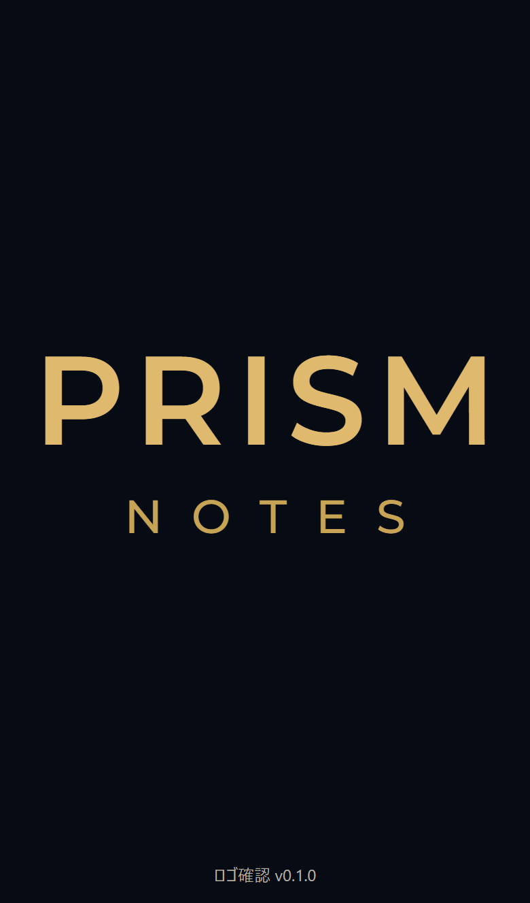
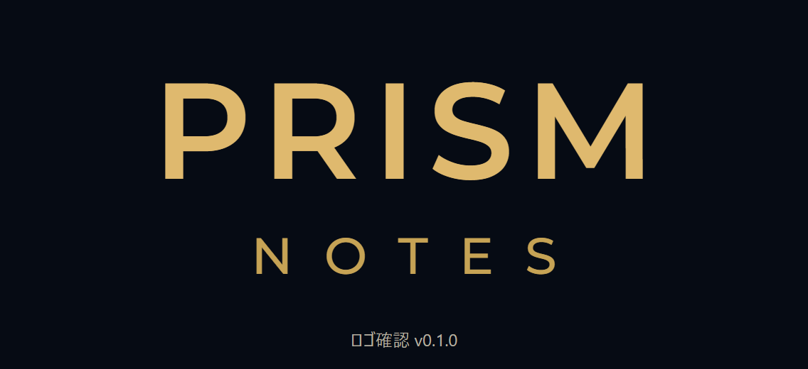

# 採用ロゴと表示確認

発案者が共有した「PRISM / NOTES」の文字ロゴを、2026-10-12に採用した。濃紺の背景、金色の文字、Montserrat 600/500、二段構成と文字サイズ・字間の比率を維持する。

- [調整版HTML v0.1.0](prism_notes_logo_preview.html)：単体のロゴ確認画面。ゲーム全体やタイトル画面の完成版ではない。
- [原本のコピー](prism_notes_logo_original.html)：共有されたHTMLを内容の変更なしで保管。Downloads内の原本も変更していない。
- [CSS](logo-preview.css) / [JavaScript](logo-preview.js)：実際に使える幅・高さと読み込まれた書体の寸法を使い、文字サイズ・字間・段の間隔を同率で縮小する。十分な広さがあれば元の96/36pxで表示する。
- [確認結果](../../設計検証/ロゴ/logo-layout-report-v0.1.0.json)：PC上のChromium・WebKit各10サイズと書体の遅延読み込み、計22件。

縦・横スクロールを隠す方法は使っていない。ロゴの両行とバージョン表示が画面内に収まり、ロゴが割り当てた領域からはみ出さないことをブラウザで確認した。対象サイズは320×480、360×640、390×664、430×780、480×240、568×260、844×310、768×1024、1280×800、240×160。これらは表示領域の仮定であり、特定機種の実測値ではない。

実際のAndroid/iPhone、ブラウザの操作欄・文字拡大・画面回転・切欠きの組合せは未確認。単体ロゴの結果を、操作ボタンや設定欄を含めたアプリ全体がスクロールなしで収まる証拠にしない。

採用版の書体はGoogle Fontsから取得したファイルをfonts/内に保持し、表示時の外部通信に依存しない。書体の同梱ライセンスは[OFL.txt](fonts/OFL.txt)。アプリ全体のPWA資材の保持・更新設計は別に残る。

HTMLに確認用バージョンv0.1.0を表示し、CSS・JavaScript・書体のURLにもlogo-0.1.0を付ける。今後の変更時はこれらの版と確認画像・結果の版をそろえて更新する。

再確認は、設計検証/check_logo_layout.cjsに`--playwright-path`でインストール済みplaywright-coreのディレクトリを、必要なら`--browser-cache`でブラウザの保存先を指定する。検証用サーバーとブラウザは終了時に閉じる。GitHubへのソース保存は、このHTMLのWeb公開やアプリのデプロイを意味しない。
