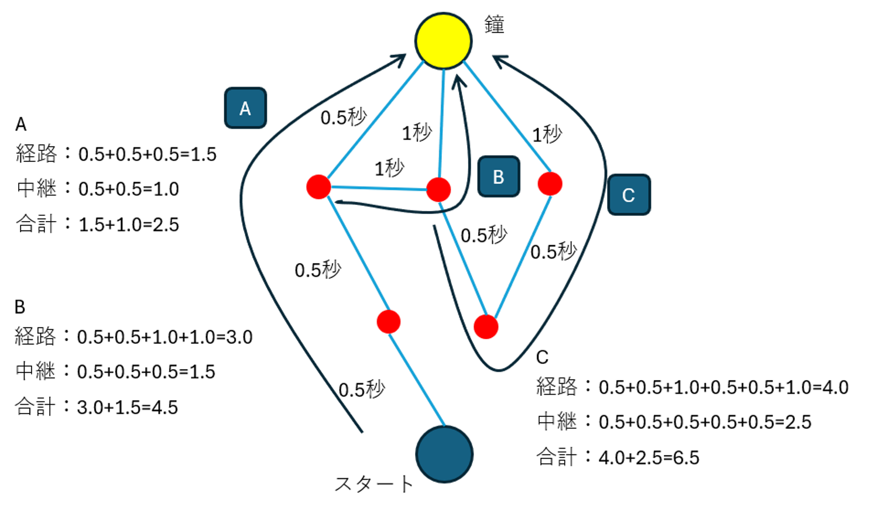

# 音の庭（仮称） 要件定義の相談記録

| 項目 | 内容 |
|---|---|
| 作成日 | 2026年10月12日 |
| 版 | 相談記録 v0.28 |
| 工程 | requirements-definition：全体確認を受け完了 |
| 用途 | 区切りごとの合意と未決事項をまとめ、要件定義書へ引き継ぐ |
| 状態 | 発案者の「ok」で文書全体の確認を完了し、要件定義書を確定版v1.0へ更新。初期版の23機能・検証範囲・仮称維持を保持。設計で具体化する事項・未確認の背景も区別して保持。設計・実装・公開の着手は未指示 |

### 現在地と要件定義の完了までの見通し

2026-10-12：最終確認版v0.6への「ok」を受け、要件定義を完了した。現在は[確定版v1.0](要件定義書_音の庭.md)。Q-01～08・12・13の方針・事実確認と文書全体の確認を終了。Q-09の試験計画は設計で具体化し、Q-10・11の未回答の背景は【要確認】として保持する。次工程は基本設計で、開始は発案者の次の依頼に従う。

主要な移動・転送・中継処理・待ち列・終点・実行操作・記録・保存・PWAの方針は確定している。決定記録はD-061まであるが、旧案の失効・訂正も含む番号であり、機能数ではない。機能F-001～F-023はすべて初期版必須として確定。設計・実機等の具体化は後工程へ引き継ぐ。

**現在の状態：個別相談・文書全体の確認とも完了し、要件定義を終了。** 本人以外への意見確認は未実施、名称は「音の庭」の仮称を維持する。Q-09は設計で具体的な試験計画・測定材料を用意する。Q-10・11は背景の【要確認】として保持し、初期版の採用を選び直す質問にはしない。未回答を解消済みと扱わない。後工程で新しい判断が必要な場合は、未決の根拠・回答で変わる内容・具体例を先に示す。機能・検証範囲は減らさない。

| 残る判断のまとまり | 相談数の目安 | 内容・残る理由 |
|---|---:|---|
| 動作・課題の評価 | 0（方針確定） | D-048～050で初回送出と受信処理、達成判定＋採点、未達成0点を確定。正解との照合・間隔の厳密な一致はD-057・058で確定。採点式・通知時点等は基本設計で具体案を用意して相談 |
| 中断・復帰 | 0（方針確定） | 手動保存した構成・条件のみ保持。未保存変更の自動退避なし（D-051）。実行途中の永続復元を採用済みとしない |
| 対応環境・公開・運用 | 0（方針確定） | 対象OS・ブラウザ、登録不要の一般公開、PWA・オフラインはD-052～054。公開先・費用・期限等の指定は現時点でなし（D-055）。具体案・担当は基本設計、版・向き・実機確認はQ-09と併せて相談 |
| 初期版の範囲と優先順位 | 0（方針確定） | F-001～F-023はすべて初期版必須（D-056）。未採用候補は保留として残す。作業順は基本設計で計画し、機能・検証範囲を独断で外さない |
| 正しさの検証・合格基準 | 0（方針・計画を区別） | Q-08の方針は確定。Q-09は設計で試験計画・測定材料を用意して具体化。未具体化の基準・未実施の検証は残し、根拠のない数値の選択や対象環境の再採用を質問しない |
| 必要性の背景 | 個別質問を保留 | 不要になる条件と作らなかった場合の影響はQ-10・11の【要確認】として完成文書に示す。既合意の検証目的・23機能・必須の優先度を聞き直さず、未回答を推定で埋めない |
| 利用者への確認状況 | 0（確認済み） | D-059。本人以外への意見確認は未実施。初期版の採用を取り消す理由にしない |
| 名称の扱い | 0（方針確定） | D-060。「音の庭」の仮称を維持し、正式名称は見た目等の相談時に決める。設計資料で仮称を使い、最終固定前に確認 |
| 文書全体の確認 | 0（完了） | D-061。「ok」を受け確定版v1.0へ更新。【想定】・【要確認】を確定扱いに変えず保持 |

完了までの手順は、（1）合意と未決を機能一覧付きの要件定義書ドラフトへまとめる、（2）上記の主要判断を一つずつ相談して残件数を示す、（3）確定・想定・要確認・失効を区別した完成版を確認する、の三段階。完成条件は、何を作るか、共通の動作、初期版の範囲、対象環境、正しさの確認方法が読み取れ、後で決める事項も担当工程と影響を明記した要件定義書があること。全画面・実装方式・計測結果が確定していることを要件定義の完了条件にはしない。

入力欄・増減ボタン等の具体的な操作、配色・素材・演出、記録の画面・ファイル形式、固定順の具体的な作り方などは、未決として基本設計で具体化する項目に分ける。基本設計へ送ることは、採用・検証対象からの除外でも、AIが任意に仕様を決めてよい許可でもない。計算結果・データ保持・操作の意味を変える選択は、その影響を示して相談する。世界観・キャラクター等も、未決の表現方針として残す。

## 1. 入力資料と扱い

- [構想たたき台_音の庭.md](構想たたき台_音の庭.md)：構想 v0.4。確定事項、提案、保留事項、決定ログを引き継ぐ。
- [DFS/BFS再利用検討のREADME](C:/Users/user/Documents/AI連携ゲーム/共有資料/音の庭_DFS-BFS再利用検討_20261012/README.md)：資料版1。既存部品の役割と再利用条件を引き継ぐ。過去のテスト結果は既存ゲームについての記録であり、音の庭の動作実績へ置き換えない。

本記録は今回の相談で決まった差分のまとめ。構想の確定事項を引き継ぎ、今回の相談で具体化した同じ項目は本記録を優先して読む。ここに記載がない事項を自動的に確定・除外しない。「確定」はユーザーの選択・指示、「【想定】」は検討中の案、「【要確認】」は未決事項。既に相談したが結論を資料から回収できない事項は「既相談・記録不足」と区別する。

### 共通の前提：目的と二つの実験

通信ネットワークの経路のイメージを元に、ダイクストラ法の検証などを行い、それをゲームのように見せる。庭・道・粒・鐘は、その経路と動きを分かりやすく見せる表現として扱う。これは構想v0.4に記載された目的であり、今回もユーザーが説明し、理解の一致を確認した。新しい方針への変更ではない。

接続を考える単位は、中継点などの点と、それらを結ぶ道。**道の両端は異なる二点とし、同じ点へ戻る一本の道は認めない（D-032）。** 同じ二点間に複数の道を作れるD-003と、複数の点を巡る循環は維持する。「同じ点へ戻る一本の道」と「別の点を巡って戻る経路」を混同しない。

| 実験 | 確定している基本動作 |
|---|---|
| 最速経路 | 道と中継点に設定した時間から最短経路を計算し、粒がその経路を自動で進む。途中で粒を複製しない。課題では一つのゴールへ一粒。自由モードでは、一つのゴールへ一粒送る方式に加え、全ゴールへ一粒ずつ同時に送る方式も選べる（D-035・D-036） |
| 広がる動作 | 一粒から始め、到着に使った道へ直ちに返さず、進める別の道へ分岐・複製する。別の道を巡って戻った粒も転送する。ダイクストラ法自体の動作とは分ける |

課題の庭・自由な庭、故障への備え、循環の実験の合意は引き継ぐ。目的の確認を理由に、これらを独断で検証範囲から外さない。

### 課題・自由の違いと、最速・広がる実験の違い

モードごとに粒の処理・行き止まり等の異なるルールを増やすと、同じ条件を比較する際の根拠が不明確になる。ユーザーの指摘と、その整理方針への「OK」を受け、課題・自由は共通の動作ルールを使うことを確定した（D-037）。全モードで同じ結果を出すという意味ではなく、同じ実験方式・同じ構成・同じ実行条件には同じ処理を適用するという意味である。

| 区分 | 合意した内容 | 未決事項の扱い |
|---|---|---|
| 共通の動作 | 道の方向・移動時間、中継点の一つの処理ゲートと待ち列、同条件での順序の再現性、鐘での終了、条件固定・停止・一時停止等。到達不能も実験を受け付けて結果に含める（D-038） | 行き止まりでは動作を終えた粒の絵を到着地点に残す（D-039）。終了した粒の結果記録の詳細は今後具体化 |
| 課題・自由で違う条件 | 課題はゲームが条件と評価を提示し、自由はプレイヤーが構成・時間・故障を設定する。課題は一ゴール、自由は一つまたは複数。課題の独立した単一故障ケースと、自由の複数同時故障等、既に合意した設定範囲は維持 | 条件の違いから、中継点の処理等の別ルールを作らない。自由に未合意のクリア条件・制限時間を追加しない |
| 最速・広がる実験で違う進み方 | 最速は宛先まで計算した経路を進み複製しない。広がる実験は到着に使った道以外へ分岐・複製する | 課題・自由の違いとは別。最速で宛先への経路がない場合、途中まで進む経路を選ぶ規則は合意していない。広がる動作に自動で切り替えない |
| 見た目との関係 | 行き止まりまで実際に進んだ粒の絵を、動作を終えた記録として残す（D-039） | 残った絵は処理ゲートを占有しない。重なった粒の見せ方等の具体的な外見は後の相談 |

この整理への「OK」を、到達不能でも動かす方針や、開始前にNGとする方針の選択には使わない。先にNGとする場合は通常の実行にも同じ基準を適用する必要がある、というユーザーの発言は条件付きの説明であり、NG方式の採用指示ではない。

その後、共通方針への「1でOKです」によりD-038を確定し、行き止まりの絵への「1」によりD-039を確定した。整理方針への返答と、後の具体的な動作・表示の選択を区別して記録する。

**鐘はエンドポイント（受信して粒の動作を終える点）として扱う（D-025）。** 課題・自由に作るモードとも、鐘から先へ粒を転送しない。ゴールの数は、課題モードでは一つ、自由モードでは一つまたは複数とする（D-036）。自由モードで鐘を複数置いて順に鳴らすことは、広がる実験で分岐した粒を別々の鐘へ時間差で届ける構成で実現できる。「順に鳴らす」ことから「鐘を通過して次の鐘へ送る」ことを導かない。鐘という呼び名や外見は引き続き仮。

自由に作るモードは、プレイヤー自身が構成を作り、流して結果を見て、条件を変えて試す実験の場とする。課題ではゲームが提示した条件の達成を目指し、自由に作るモードではプレイヤー自身の疑問を試せる。光や音の模様を楽しむことも含む。道・中継点の時間の変更はD-016、実行開始と変更のタイミングはD-017・D-018で具体化した。

自由に作るモードへ、ゲーム側が課すクリア条件や制限時間を採用した合意はない。道・中継点の設定時間と、実験を打ち切る制限時間は別の条件である。構想の制限時間案は検討候補のままとし、課題の間隔・回数の達成条件（D-010〜D-012）を自由実験へ持ち込まない。

相談途中の「自由な庭の最速実験で、目的の鐘を選ぶか／自動で選ぶか」という質問は未回答のまま保留にしていた。その後ユーザーが、複数ゴールならゴール数分の粒を同時に送れるかを提案し、「一つのゴールへの送信に加え、全ゴール同時送信も用意する」を選択した（D-035）。現在はこの合意を引き継ぐ。ゲームが最も近いゴール一つを自動選択する案は採用していない。ボタン等の具体的な操作は今後決める。

### 同じ時間の経路：評価と表示の選択を区別する

構想v0.4から引き継ぐ確定事項：

- 正答を一経路だけにせず、面の評価条件で最高評価を得られる経路を複数用意する。
- 時間だけを評価する面では、同じ合計時間なら道の本数で評価差を付けない。
- 時間と道の本数を評価する面では、時間を優先し、同じ時間なら道の本数が少ない経路を高く評価する。

**確定（D-015）**：同率の経路は、同じ条件なら毎回同じ経路を選ぶ。条件には、接続・方向・道と中継点の時間・故障状態・適用する評価条件を含む。具体的な固定順の作り方は基本設計で定め、この再現性を守る。時間と道の本数を評価する面では、その評価条件を満たす経路の中から選ぶ。表示用に一経路を選ぶことを理由に、他の最高評価経路を不正解にしない。

記録の経緯：v0.2では、既に相談した経路選択の結論を資料から特定できず「既相談・記録不足」と記録した。今回ユーザーが「1（同じ条件なら毎回同じ経路を選ぶ）」と明示したため、v0.3で解消した。課題の正答評価と、再生する経路の選択規則は引き続き区別する。

### 呼び名・見た目・実装方式の未確定範囲

構想v0.4の仮称・【想定】・未決事項を引き継ぐ。今回のユーザーの確認に対し、以下はまだ確定していないと整理する。

| 対象 | 現在の扱い |
|---|---|
| タイトル | D-060で「音の庭」の仮称維持を確認。正式名称は見た目等の相談時に決める |
| モード名・オブジェ名・その他の呼び名 | 「課題の庭」「自由な庭」「石」「鐘」「粒」等は相談用の呼び名。役割や動作の合意を、名称・外見の決定へ置き換えない |
| 世界観・キャラクター | 庭・石・花・鐘等は表現案。具体的な世界観、キャラクターの採用・姿・名前は未決 |
| フロントエンドの見た目と操作の細部 | 具体的な画面構成、配色、書体、素材、ボタン配置、演出は未決 |
| フロントエンドの実装方式 | D-054でPWAとオフライン利用を採用し、実験に必要な計算・データを端末内で使える設計を要求する。具体的な技術・描画・音・資材保持・更新方式は未決 |

通信ネットワークを土台にゲームのように見せる方向、PC・スマホ・タブレットの対応、消音でも理解できること、二つの実験など、既に合意した機能・条件は保持する。見た目や名称が未決であることは、これらも未決であるという意味ではない。

## 2. 相談の進め方

- 仕組み・前提を先に説明し、具体例を示してから判断を求める。
- 質問の対象を「課題／自由」「最速／広がる」「動作／入力操作／評価」の必要な範囲で明示する。時間設定の相談では誰が設定するのかを先に説明し、課題の達成条件を自由モードの入力仕様の理由として混ぜない。入力の刻みと、手入力・増減ボタン等の操作方法は、関係を説明したうえで確定状況を分ける。
- 一度に相談する判断は一つ。選択肢は2〜3個に絞り、おすすめと理由を示す。
- 相談の最初・区切り・見積もりが変わった時点で、現在地、残る主要判断、次の到達点を知らせる。要件定義と基本設計の項目を混ぜて無期限に質疑を続けない。
- 仮の数値、ユーザーが示した数値、図から計算した値を明確に区別する。
- 前提を変えた場合は明示する。理解の確認と仕様の選択を区別し、理解への返答だけを仕様の確定に使わない。
- 文書は区切りごとにまとめて反映し、選択のたびには更新しない。
- 新しい質問の前に、構想・本記録・利用できる会話の合意を照合する。文書にないことだけを理由に未相談と判断しない。既相談の結論が回収できない場合は、記録不足として示し、再決定を求めない。
- 先に保留した事項と、それを前提にする新しい質問の関係を整理する。依頼者から整理を求められた場合は新しい質問を止め、確定・保留・未回答を見える形にする。整理のためにAIが置いた順番を、仕様の合意と扱わない。
- 質問がどの動作・使い方を決めるために必要かを説明する。表示の相談はユーザーの指示どおり後に回し、自由実験へ未合意のクリア条件・制限時間を追加しない。
- 道の接続単位など、判断に必要な前提を引継ぎ資料に明記する。確定した入力ルールと、実験中の動作の条件を区別する。利用目的との関係を説明できていない細かな例外を、主要な未決事項より先に持ち出さない。
- 技術的な難しさは説明する。難しさや既存コードの都合で、検証対象を独断で外したり転送ルールを変更したりしない。

## 3. 今回の相談で確定した事項

以下の番号は相談記録の番号。正式な機能IDは要件定義書の機能一覧で採番する。

| 記録 | 項目 | 確定内容 |
|---|---|---|
| D-001 | 対応端末 | PC・スマホ・タブレットで、庭の編集から実行・結果確認まで遊べる。対象OS・ブラウザ・画面の向き等は未決 |
| D-002 | 道の方向 | 片方向・両方向を扱う。課題ではお題が指定し、自由な庭では道ごとに選択できる。混在も認める |
| D-003 | 同じ二点の複数の道 | 認める。それぞれ別の道として、所要時間・故障・線の本数を扱う |
| D-004 | 最速経路の合計時間 | 通る道の移動時間と、途中の中継点の処理時間を足す。粒の出発からゴール到着までを測る |
| D-005 | 出発点・ゴールの処理【適用範囲変更】 | 最初の出発とゴールは合計時間に処理を含めず、隠れた0.5秒を設定・表示しない。2026-10-12のD-048により、戻った出発点での受信処理はこの時間非加算の対象から外し、中継点と同じ処理を適用する |
| D-006 | 道の時間【一部訂正】 | 通常の道を0.1秒以上とする合意は維持。~~0秒の道は検証用条件として残し、最速計算・循環の検証から除外しない~~という例外の記録は2026-10-12に訂正。アプリで扱う道の現在の条件はD-031、中継点の処理時間はD-013を参照 |
| D-007 | 広がる実験の鐘【失効】 | ~~受け取った粒を止める／次へ送るを選べる。課題ではお題が指定し、自由な庭では鐘ごとに選べる~~。2026-10-12：後の「鐘はエンドポイント」という指示を現在の共通前提として反映できていなかった記録を訂正。置換先：D-025 |
| D-008 | 鐘を経由する遊び【失効】 | ~~自由な庭で、鐘1で鳴らして次へ送り、鐘2で鳴らして止める構成も作れる~~。2026-10-12：鐘を終点とする前提に訂正。複数の鐘を順に鳴らす構成は、鐘間の転送を必要としない。置換先：D-025と後述の分岐の説明例 |
| D-009 | 再来時の発音 | 鐘は粒が届くたびに鳴る。D-025に従い受信した各粒の動作はそこで終了する。別の経路や循環から後で届いた粒も受信として数える。一定回数鳴ったことだけを理由に、その後の受信を数えなくするルールは追加しない |
| D-010 | 間隔・回数のお題 | 「指定された間隔で鐘を鳴らす」を課題の庭に採用する。「最初の到達から2秒おきに合計3回」はユーザーが示した具体例 |
| D-011 | お題と無関係な循環 | 対象の鐘へ粒が届かない別の循環が残っていても、対象の鐘の間隔・回数を満たせば達成とする。すべての粒が止まることを、このお題の追加条件にはしない |
| D-012 | 鐘の合計回数の判定範囲 | 将来の追加到達も含める。有限の観察区間内で3回鳴ればよい条件にはしない。後で4回目が届く構成は「合計3回」を満たさない。達成を知らせる時点は後のD-040で確定。追加到達を確認する計算方法・未達成を知らせる時点等は未決 |
| D-013 | 中継点の0秒処理 | 0秒を認める。D-031に従いアプリの道はすべて0.1秒以上とするため、中継点が0秒でも道を通って一周する輪には正の時間がかかる |
| D-014 | 広がる実験で出発点に戻る粒 | 出発点も、戻った粒を到着に使った道以外の進める道へ転送する。戻ったことを理由に新しい粒を追加しない |
| D-015 | 同率の経路の選択 | 同じ条件なら毎回同じ経路を選ぶ。ランダムに選ばない。表示する一経路の固定と、複数の最高評価経路を認める採点は分ける |
| D-016 | 自由に作るモードの時間編集 | プレイヤーが道と中継点の時間を変更できる。接続を保ったまま時間条件を変える実験もできる。道の最小時間と中継点の0秒処理はD-031・D-013に従う。課題の時間をゲーム側が決める合意は変更しない |
| D-017 | 構成を作ってから実行する | 経路を結線し、時間など実験条件を設定した後、「決定」「流す」などの明示的な操作で実行を開始する。操作名と、構成の決定・実行開始を一つの操作にするかは未決 |
| D-018 | 自由に作るモードの実行中の変更 | 実行中は条件を変えず、停止してから編集する。停止時は粒を消し、作った構成を保持する。変更後は停止前の粒の途中状態を引き継がず、新しい実験を始める。広がる実験と一つのゴールへの最速実験は一粒から、D-035で追加した全ゴール同時送信はゴールごとに一粒から始める。最速で経路がない宛先の扱いは、その後確定したD-038に従う。停止後の結果の保持はD-019を参照 |
| D-019 | 停止後の結果 | 停止した時点までの結果を、前回の実験結果として残す。編集後の構成の結果と混同しない。次の実行を始めたら新しい結果に切り替える。複数回の履歴保存や比較機能の採否は未決 |
| D-020 | 転送先のない中継点 | 到着に使った道以外に進める道がなければ、それ以上転送しない。実行中は条件を固定するため、道の追加を待つ動作にはしない。当時保留した到着後の粒の絵は、その後D-039で残すことに確定 |
| D-021 | 中継点の処理ゲートと順番待ち | 中継点の処理ゲートは一つとし、一粒ずつ処理する。処理中に届いた粒は待ち列に入り、先の処理が終わってから自分の処理時間だけ処理を受ける。同時到着でも粒を一括処理しない。基本の待ち列の上限はD-022、同時到着した粒の処理順はD-029を参照 |
| D-022 | 基本の待ち列の上限 | ルール上の上限を設けず、届いた粒をすべて並べる。上限超過を理由に粒を捨てる動作を基本ルールへ追加しない。実機で扱える量・限界時の対応は別途測定・相談する |
| D-023 | 自由に作るモードの故障実験 | 道・中継点を削除せず、一時的に使えない状態へ設定できる。状態の変更は停止中に行い、選んだ状態で実行する。元の配置・接続・時間設定を残して、故障前・故障中・復旧後を比較できる |
| D-024 | 自由実験で同時に使えなくする箇所 | 複数の道・中継点を同時に指定できる。一箇所の故障も、複数箇所が重なる故障も試せる。課題の庭で、一箇所ずつ元の構成から独立して確認する合意は変更しない |
| D-025 | 鐘の役割 | 鐘はエンドポイントとして受信時に鳴り、受信した粒の動作を終える。鐘から先へは転送しない。終点の鐘に中継処理時間・転送の順番待ちを追加しない。課題・自由に作るモードの共通前提とする。D-007・D-008の古い転送案を置き換える |
| D-026 | 自由実験の保存と再実行 | 自由モードで作った構成と実験条件を保存し、後から読み込んで再実行できる。保存先はlocalStorage（ブラウザ内の保存領域）。保存するかどうかはユーザーが選択する。課題モードの進捗保存をこの合意に含めない |
| D-027 | 保存数と置き換え | 最大10パターンを保存できる。満杯の状態で新しいパターンを保存する場合は、ユーザーが置き換えるスロットを選択する。既存の構成はユーザーの回路の案であり、古い順などの規則で自動的に消したり、アプリが無断で置き換えたりしない |
| D-028 | 自由実験の保存対象 | 保存スロットには回路の構成と実験条件を保存し、実験結果を含めない。結果は読み込んだ構成を再実行して確認する。停止直後の結果を残すD-019は引き続き有効 |
| D-029 | 同時到着した粒の処理順 | 同じ条件なら毎回同じ順に処理し、同時到着の順序をランダムにしない。具体的な固定順の作り方は基本設計で定める。経路別の色分け・ラベル表示等を採用した合意には使わない |
| D-030 | 自由実験の実行中の粒の追加 | 自由モードの広がる実験では、実行中に手動でも粒を追加しない。試し直す場合は停止し、一粒から再実行する。分岐による複製や別の道を巡って戻った粒の転送は維持する |
| D-031 | アプリの道の最小時間 | 課題・自由モードのどちらも、道の移動時間は0.1秒以上とする。アプリ内に0秒の道を設定する例外を設けない。中継点の0秒処理はD-013のまま維持する。D-006の0秒の道の例外を置き換える |
| D-032 | 道の両端 | 道は異なる二点を結ぶ。同じ点を接続元・接続先にする一本の道（A→A）は認めない。A→B→C→Aなど、異なる点と道を組み合わせた循環は認める。ユーザーの今回の「1」で確定し、未決・保留として再質問しない |
| D-033 | 一時停止と再開 | 両モードに一時停止・再開を用意する。一時停止では粒・待ち列・実験の時計を保持し、再開すると途中状態の続きから動かす。一時停止中に条件は編集しない。条件を変える場合はD-018に従い停止し、編集後に新しい粒で再実行する。開始時の粒数はD-018・D-035に従う |
| D-034 | 自由実験の回路ファイルの受け渡し | 自由モードの回路と条件をファイルに書き出し、別端末で読み込んで試せるようにする。対象はD-028と同じ構成・条件であり、実験結果や実行途中の粒の状態を含めない。localStorageの任意保存・最大10パターン・ユーザーによる置換先選択は維持する |
| D-035 | 自由モードの最速実験の同時送信 | 一つのゴールへ一粒送る方式に加え、全ゴールへゴールごとに一粒ずつ同時に送る方式も用意する。各粒には宛先を持たせ、それぞれ道と中継点の設定時間から計算した最短経路を進ませる。途中で複製しない。共有する中継点ではD-021・D-029の順番待ちを適用する。自由モードだけの追加であり、課題の最速実験を複数粒へ変更しない。経路がない宛先は、その後確定したD-038に従って粒を移動させず、到達不能を結果に含める |
| D-036 | モードごとのゴール数 | 複数のゴールを置けるのは自由モードのみ。課題モードのゴールは一つ。自由モードは一つまたは複数とする。課題の間隔・回数のお題は、一つのゴールへ時間差で複数回届く条件として扱う |
| D-037 | 課題・自由の共通動作ルール | 課題・自由で粒の移動、中継処理・順番待ち、鐘での終了、行き止まり・到達不能の扱い等のルールを共通にする。違いは既に合意した構成・時間等の設定範囲、ゴール数、課題の評価条件等。最速・広がる実験の進み方の違いは別軸として維持する。この合意時には未決だった到達不能の具体的な扱いは、後のD-038・D-039で確定 |
| D-038 | 到達不能も実験結果として扱う | 課題・自由とも、ゴールへ届かない構成も実験として受け付け、到達不能を結果に含める。最速実験で宛先までの経路がなければ粒を移動させず、経路がないことを結果に残す。広がる実験では既存の転送ルールで進める道を進む。到達不能だけを理由に開始を拒否しない。A→A等の確定した入力条件は変更しない |
| D-039 | 行き止まりの粒を残す | 行き止まりまで進んだ粒は、そこで動作を終え、到着した地点に絵を残す。絵は動作を終えた記録として扱い、中継点は次の粒を処理できる。残った絵を処理中・待ち列に戻したり、処理ゲートを塞ぐ粒として扱ったりしない。行き止まりでの選択であり、鐘に到着した粒の絵の扱いまで確定しない |
| D-040 | 課題の間隔・回数のお題で達成を知らせる時点 | 指定どおり必要な回数の粒が実際に鐘へ到達し、以後の追加到達もないと確認できた時点で達成を知らせる。「2秒おきに合計3回」なら3回目の到達後。開始時に計算結果だけで達成を先に知らせる方式にはしない。確認方法は未検証であり、任意の観察時間で打ち切ることや、対象と無関係な循環を止める条件は追加しない。自由モードのクリア条件の採用ではない |
| D-041 | 自由モードの時間設定の刻み | プレイヤーが設定する道の時間・中継点の処理時間は0.1秒刻みとする。道は0.1秒以上、中継点は0秒以上という既存条件を維持する。手入力・一定量の増減ボタン・最小単位での上下調整等はユーザーが挙げた入力方法の候補であり、具体的な採用方法は画面・操作の相談で決める。課題でプレイヤーが時間を設定する合意や、自由に「2秒おき」等の条件を課す合意ではない |
| D-042 | 続行困難な負荷での自動一時停止 | 課題・自由とも、端末の処理負荷により続行が難しい場合は、粒・待ち列・実験の時計を保持して自動で一時停止する。その時点の状態を確認し、ユーザーが再開するか、停止して編集するかを選べる。負荷の判断基準は実機の測定後に詰める。待ち列のルール上の上限、粒の無断破棄、時間の改変、循環の検証除外は追加しない。無制限の状態保持や、同じ端末で再開すれば必ず続行できることを性能確認済みとは扱わない |
| D-043 | 粒ごとの途中の実行記録 | 課題・自由とも、到達結果と集計に加え、粒ごとに通った道、中継点への到着時刻、処理開始・終了時刻を記録し、途中の経緯を確認できるようにする。到着から処理開始までの順番待ち、処理開始から終了までの処理時間を確認できる。現在の実験結果として扱い、停止後の結果保持・次の実行開始時の切り替えはD-019に従う。保存スロット・回路ファイルへ結果を追加保存する合意ではない。記録の具体的な画面、複製の親子関係の記録、記録量が増える場合の保持方法等は未決 |
| D-044 | 課題の結果確定後の継続 | 課題の達成・未達成を知らせても、それを理由に実行を自動停止せず、動いている粒は通常のルールで動作を続ける。ユーザーが一時停止・停止を選べる。達成通知の時点はD-040、続行困難な負荷での自動一時停止はD-042を維持する。結果確定後に粒の転送や時間のルールを変えない |
| D-045 | 一時停止中に次の動作まで進める | 課題・自由とも、一時停止中に次の粒の到着・処理終了まで進め、再び一時停止する機能を用意する。通常実行と同じ移動・処理時間と転送・待ち列のルールで動かし、実験の時計と途中の記録もその進行に合わせて更新する。同時到着等の順序はD-029に従う。一時停止中の条件固定はD-033を維持する。操作の具体的な画面、同じ時刻に複数の出来事がある場合の区切り方等は未決 |
| D-046 | 実験条件と実行記録のファイル書き出し | 課題・自由とも、ユーザーの操作で、実験条件と実行記録を別ファイルに書き出せるようにする。変更前・変更後の記録を後で確認・比較する用途。10個の保存枠と既存の回路ファイルは引き続き構成・条件のみを対象とする。実行途中から復元・再開する機能や、アプリ内の複数結果比較画面の採用ではない。形式・項目の具体化は未決 |
| D-047 | 自由モードで回路を読み込む際の編集内容の保護 | 実行を停止して編集中に、保存済み回路や回路ファイルを読み込む場合は、現在の構成を保存してから入れ替える、保存せず入れ替える、読み込みを取り消す、をユーザーが選べるようにする。編集対象は一つとし、複数の構成を別々の作業として同時に開く方式は採用しない。保存時はD-027の最大10パターン・置き換え先のユーザー選択を維持し、確認だけで既存スロットを自動的に上書きしない。具体的な画面・文言は未決 |
| D-048 | 初回送出と、出発点へ戻った粒の受信処理 | 初回はすぐに出力できる状態として処理・待ち時間なしで送出。戻った粒は入力を受けてから出力する状態として、中継点と同じ一つのゲート・処理時間・待ち列を適用し、処理後に到着に使った道以外へ転送する。課題・自由共通。D-005の処理時間非加算は最初の出発に限る扱いへ変更。ユーザーの「出発と中継では用途が異なるので2」の説明に基づく |
| D-049 | 課題の達成判定と点数 | 課題では条件の達成判定に加えて点数を計算する。達成判定と点数は別に扱う。既存の時間・本数・故障・間隔回数の評価条件を維持。具体的な採点式等は未決 |
| D-050 | 未達成の課題の点数 | 未達成は0点。達成した構成を採点し、未達成での途中の成果だけに点数を付けない。10故障ケース中8ケースだけ届く例は未達成0点。例のケース数を全課題の固定値にしない |
| D-051 | 終了後に残す自由モードの編集内容 | ユーザーが手動保存した構成・条件だけを残す。保存せずにアプリを閉じた場合、未保存の変更は残さず、作業途中の自動退避を設けない。保存済みの1秒の道を2秒へ変更して保存せず終了した例では、2秒の変更は残らず、保存済みの1秒が残る。例の値は固定の初期値ではない |
| D-052 | 対象OS・ブラウザ | PCはWindowsのChrome・Edge、macOSのChrome・Safari。スマホ・タブレットはAndroidのChrome、iPhone・iPadのSafari。具体的な版・画面の向き・実機の確認範囲は未決としてQ-09・基本設計で相談。対応要件であり、実機検証済みの宣言ではない |
| D-053 | 公開範囲・利用者の入口 | 誰でも利用できる一般公開。URLを開けば利用登録なしで実験・プレイできる。公開先のサービスは未決。アプリの一般公開であり、回路や結果の自動公開、実際の公開・デプロイの着手を指示した合意ではない |
| D-054 | PWA・オフライン利用 | 「PWAでネットがなくても使いたい」というユーザー指定に基づき採用。必要資材の初回取得後にネット接続なしで起動し、課題・自由の編集・実行・音・手動保存・ファイル入出力を使える要件。PWAの資材保持と回路の任意保存を区別し、未保存の編集内容の自動退避は追加しない。初回準備・新しい版の取得には接続が必要。追加・更新・保持・通信断・再起動の具体的な方式と実機確認は未実施 |
| D-055 | 公開・運用の指定条件 | 公開先・費用・期限等に現時点で指定なし。具体案は基本設計で相談する。未指定を費用・納期・外部サービスの任意決定の許可にしない |
| D-056 | 初期版の範囲・機能優先度 | 合意済みの23機能F-001～F-023をすべて初期版に含める。全機能を初期版必須とし、課題・自由、故障課題・採点・チュートリアル、PWA等を独断で後続へ回さない。自動生成等の未採用候補は保留の記録を維持。循環の将来到達判定・粒の増加と負荷等の技術検証は必要であり、初期版の選択を検証完了と扱わない |
| D-057 | 正解との照合方法 | 「小さな構成で全候補経路を調べる＋手計算の時刻表」をユーザーが選択。最短経路は別の方法で候補を調べた最小時間、分岐・循環・待ち列・再来は手計算の到着・処理開始・終了時刻と照合。具体的な試験構成と将来到達の確認方法の検証は未実施。元の検証候補は維持 |
| D-058 | 課題の指定間隔の一致 | 計算上、指定間隔への厳密な一致を求める「1」をユーザーが選択。最初2.5秒・間隔2秒なら次は4.5秒・6.5秒。前後0.1秒を認める提案は未採用。小数計算の誤差・表示丸めで判定を変えず、描画・発音の遅れとは分ける。入力方法・自由モードのクリア条件を変更するものではない |
| D-059 | 想定利用者への意見確認の状況 | 本人以外の想定利用者に意見を聞いたことがあるかという確認へ「いません」と回答。意見確認は未実施として記録。初めて使う人の理解・操作性を確認済みとは扱わず、試遊の対象・方法を基本設計で具体化する。初期版の採用・必須の優先度は維持 |
| D-060 | 名称の扱い | 「仮称『音の庭』のまま進める」をユーザーが選択。正式名称は見た目等の相談時に決める。設計資料では「音の庭（仮称）」を使い、画面タイトル・公開URL・リポジトリ名等を最終固定する前に発案者へ確認。世界観・キャラクター・正式な呼び名を確定したものではない |
| D-061 | 文書全体の確認・要件定義の完了 | 最終確認版v0.6の全体確認へ「ok」と回答。要件定義書を確定版v1.0とし、要件定義を完了。全23機能の初期版必須、共通動作、検証範囲とBD-01～14の申し送りを保持。【想定】・【要確認】を確定・検証済みへ変えない。設計・実装・公開の開始は別の依頼に従う |

### 質問候補の点検と進行の修正（v0.26時点）

2026-10-12：D-058への「1」と「この質問の意図は？？」に続き、「こんな質問が他にないか確認」と依頼された。許容幅を持ち出した質問は、検証目的から厳密な一致を整理すればよく、不要な選択を増やしていた。照合方法の技術選択も、元資料と目的に沿う案を担当が用意する余地があった。回答はD-057・058として保持し、再質問しない。

残るQ-08～13、BD-01～12、元資料・決定記録を点検し、[要件定義書20.4](要件定義書_音の庭.md#204-質問候補の点検2026-10-12)へ結果を記載した。測定前に根拠のない性能数値を選ばせること、採用後に機能の必要性を一つずつ問い直すこと、内部の数値表現等を好みの選択にすることを避ける。背景の未回答は【要確認】として保持し、事業上の損失なし・利用者調査なし等の事実を勝手に確定しない。

次の質問は、既合意と目的から導けないこと、回答で変わる内容または必要な事実、具体案・根拠を点検してから作る。課題／自由、時間の設定者、計算・表示の区別を共有する。技術的な困難は報告し、相談の整理を機能・検証範囲の除外へ置き換えない。点検時の個別相談候補はQ-12・13の2項目だった。その後、D-059・060で回答を記録し、D-061で文書全体の確認も終了した。

### PWAの資材保持と、回路の手動保存を分ける

PWAで端末に保持する資材は、アプリを動かすための画面・処理・音・課題等。回路の保存はD-026～028・051に従いユーザーの明示操作で行い、未保存変更を勝手に退避しない。

2026-10-12に[MDNのオフライン動作](https://developer.mozilla.org/en-US/docs/Web/Progressive_web_apps/Guides/Offline_and_background_operation)、[インストール条件](https://developer.mozilla.org/en-US/docs/Web/Progressive_web_apps/Guides/Making_PWAs_installable)、[資材保持](https://developer.mozilla.org/en-US/docs/Web/Progressive_web_apps/Guides/Caching)を確認。資材の初回取得・更新には通信が必要。OS・ブラウザごとに追加方法等が異なるため、D-052の対象で実機確認する。技術資料の確認と、本アプリの動作確認を混同しない。基本設計で資材の保持・更新・未準備時の案内を詰め、オフラインを理由に対象機能を独断で外さない。

### 出発点の初回送出と、再来時の中継処理

初回はすでに出力できる状態であり、入力を処理してから出力する再来時とは用途が異なる。D-048でこの区別を確定した。出発点に隠れた0.5秒を加える訂正ではなく、受信した粒に中継点と同じ処理を適用する変更である。処理時間は中継点と同様に、課題ではゲーム側、自由ではプレイヤーの設定として扱う。具体的な表示は未決。

例えば出発点→A→B→出発点の道3本・中継点2つが各0.5秒なら2.5秒に戻る。戻った出発点の処理時間も0.5秒でゲートが空いていれば、3.0秒に次の道へ送出する。この0.5秒は説明例であり固定値ではない。ゴールへ向かう元のユーザー図のAルートは引き続き2.5秒である。

### 実行途中の確認と、保存する回路の区別

D-043で確認する時刻は、現在の実験の出発から測る計算上の時刻。説明用の例として、Aに1.0秒で到着し、1.5秒に処理を始め、2.0秒に処理を終えた場合、待ち時間は0.5秒、処理時間は0.5秒と分かる。端末の描画・音の遅れを、これらの経路や処理の時間へ加算しない。

全経路の記録は、従来は同時到着順の合意だけから採用できないとして未決に残していた。その後、途中の動作記録に対する明示的な「1」により、D-043の範囲で採用した。粒を識別して通過の経緯を確認する機能と、経路別の色やラベル、複製元との関係の見せ方は分ける。

現在の実験結果を確認できることと、後日のために結果を保存・書き出しできることは別の機能である。途中の記録を採用したD-043だけから書き出しを追加せず、その後の明示的な選択でD-046を採用した。D-028の保存スロットとD-034の回路ファイルは引き続き構成・条件のみを対象とする。アプリ内への結果の長期保存等は、ファイル書き出しから自動的に追加しない。

### 課題の達成判定と、自由モードの時間入力を分ける

課題ではゲームが道・中継点の時間とお題を決め、プレイヤーは結線して試す。自由モードではプレイヤーが道・中継点の時間を設定して実験する。時間を計算・処理する基本動作は共通だが、誰が条件を設定するかと、達成判定の有無はモードの用途による。

D-040は課題の「指定間隔・合計回数」を満たした後に達成を知らせる方針。D-041は自由モードのプレイヤーによる時間入力の刻み。AIはD-041の相談で、課題の「2秒おき」の一致判定を理由として持ち出し、対象と設定者を明示しなかった。ユーザーの指摘を受け、この理由付けを撤回し、課題の時間をユーザーが設定することも、自由に達成条件を課すことも採用していないと説明し直した。その後、ユーザーが入力方法との関係も示しつつ「1の方向」と選択したため、0.1秒刻みを確定した。

0.1秒刻みは設定できる値の条件であり、画面の操作方法を決めたものではない。例えば0.5秒から0.6秒へ変更できる値の条件は確定だが、数値を打ち直すか、増減ボタンを押すか、両方を用意するかは未決。これらはPC・スマホ・タブレットでの操作と合わせて後で相談する。設定値の上限、入力途中の値の扱い等も未決。課題側の時間値の細かさを、この自由モードの選択だけから新たに制限しない。

### 自由モードの全ゴール同時送信と、時間の意味

従来の最速実験は、一回に一粒だけを送る前提だった。ユーザーの提案と「1」の選択により、自由モードに限り、全ゴールへ一粒ずつ同時送信する方式を追加した。一つのゴールへの一粒の送信も維持し、広がる実験の「一粒から始め、途中で複製する」動作は変更しない。その後のユーザーの確認で、複数ゴールを許容するのは自由モードのみと明確にした（D-036）。課題のゴール数を限定する記載は以前明確でなかったため、現在の条件として明記する。

同時送信でも、経路は道と中継点の設定時間から計算して決める。各粒はその経路を進み、共有する中継点では順番を待つ。したがって「待ち時間を含めず計算した最短経路の時間」と「順番待ちを含む実際の到達時間」を区別する。順番待ちを先読みして経路を選び直す機能や、複数粒全体の到達時間を最小にする経路の組み合わせの計算は、今回の合意から自動的に追加しない。

各粒の宛先を計算上保持することは、経路・宛先別の色分け等の表示の採用を意味しない。

D-038の共通方針から、一部ゴールに経路がない場合も実験を受け付け、経路があるゴールへの粒は送信し、経路がないゴールは到達不能として結果に含める。例えばゴールAへの経路だけがあり、Bには経路がない場合、Aへ一粒を送り、Bへの移動は行わず、Bの到達不能も記録する。D-035の宛先ごとの送信とD-038を適用した帰結であり、モード独自の新しい例外や、Bの結果を無断で除外するルールではない。以前の二案の質問は直接回答されなかったが、その後の共通方針により扱いが定まったため、別途同じ選択を求めない。

### 一時停止・再開と、保存ファイルの扱い

一時停止は、進行中の粒や順番待ちをそのまま確認するための操作。D-018の停止とは別であり、停止して条件を編集した後の実行を途中状態から再開する仕様には変更しない。D-033の採用は、実行途中の状態をファイルへ保存して別端末で続きから再開する機能の採用ではない。

D-034では、PCで作った回路と条件をファイルで受け渡し、タブレット等で読み込んで実験する使い方を採用した。別端末のlocalStorageへ自動で同期する機能を採用したものではない。ファイル形式、読み込み時の現在の編集内容の保護、読み込んだ構成を保存する操作、形式不正や非対応のデータの扱いは今後具体化する。既存の保存スロットを無断で消去・置換しないD-027を守る。

### 道の0秒条件の訂正と、実装中のテストの区別

ユーザーは、以前の記録にあった「検証用」を、自由モードではなく処理の実装中のテストという意味で受け取っていた。AIは、どこで設定する条件なのかを定めないまま0秒の道の例外を記録し、アプリで0秒の循環をどう扱うかを相談していた。

ユーザーが道の0秒許容を訂正したいと述べ、「課題・自由モードとも道は0.1秒以上、0秒の例外なし。中継点の処理は0秒を認める」という訂正を確認したため、D-031として現在のアプリの条件を明記する。道を含む輪の一周には必ず時間がかかる。先ほど提示した0秒循環の自動停止／手動転送の質問は、どちらも選択されておらず、アプリの機能としての相談を撤回する。

実装中のアルゴリズム単体のテストと、プレイヤーがアプリで設定できる条件を区別する。開発時に0秒等を確認するテスト範囲は別途整理し、今回のアプリの入力条件から、開発テストの採用や禁止を自動的に導かない。正の時間の循環、増え続ける粒・待ち列の検証は引き続き残る。

### 自由モードの保存：回路の案を残す

保存の採用と複数構成の保存について、ユーザーがそれぞれ「1」を選択し、自由モードを対象とすることを確認した。その後、保存先・保存の任意性・最大数・満杯時の置き換え方法をユーザーが具体的に指定したため、D-026・D-027としてまとめた。

保存するのは、後から同じ条件で実験できる構成と設定。実行途中の粒を引き継ぐ再開機能を採用したものではなく、再実行はD-018・D-035に従い新しい粒で始める。D-028で、保存スロットへ実験結果は含めないことを確定した。停止直後に前回結果を残すD-019と、保存した構成を後日読み込める機能は区別する。

「勝手に消さない」は、アプリが上限対応として既存の案を自動削除・置換しない要件。外部ファイルへの書き出し・読み込みは、その後D-034で採用した。保存の失敗時の扱い、オンラインでの共有・公開、課題の進捗保存等は別の未決事項であり、保存先の指定から自動的に採用・除外しない。

### 編集・実行・停止の基本的な流れ

1. 結線・時間設定などで構成を作る。
2. 明示的な開始操作で、その条件の実験を始める。
3. 実行中は条件を固定して、粒の動きと結果を確認する。
4. 条件を変更するときは停止する。粒を消し、構成は残す。
5. 構成を編集し、再び開始操作を行うと新しい粒で実験を始める。広がる実験と一つのゴールへの最速実験は一粒、自由モードの全ゴール同時送信はゴールごとに一粒（D-035）。

これは実験の動作条件の合意であり、具体的な画面構成やボタン名の確定ではない。停止で粒を消すことと、実験結果や到達の記録も消すかどうかは別の判断。D-019で停止時点までの結果を残すことを確定した。

### 中継点の処理：一つのゲートで一粒ずつ

今回のユーザーの前提は「中継点に処理できるゲートが一つだけある」。そのため、処理中に次の粒が到着した場合は、先の粒の処理終了を待ってから自分の処理を始める。

以下はユーザー提供の分岐経路図とは別の説明例。中継点の処理時間が0.5秒で、最初はゲートが空いている条件。

| 粒 | 到着時刻 | 処理開始 | 処理終了・次へ進める時刻 |
|---|---|---|---|
| 一粒目 | 出発から1.0秒 | 1.0秒 | 1.5秒 |
| 二粒目 | 出発から1.2秒 | 一粒目の終了後の1.5秒 | 2.0秒 |

二粒目は0.3秒の順番待ちに加え、自分の処理時間0.5秒がかかる。道や中継点に設定した時間へ、順番待ち時間を加算して広がる実験の時刻を求める。端末の描画の遅れを、この順番待ち時間へ含めない。

二粒とも1.0秒に到着した場合も、先に処理する粒は1.5秒、次の粒は2.0秒に処理を終える。D-029で、同じ条件なら毎回同じ順に処理することを確定した。具体的な固定順の作り方は基本設計で定める。元が同じ粒であることを理由に、二粒を一粒へ統合したり受信回数を減らしたりしない。

広がる動作で到着に使った道へすぐ戻さないため、計算には各粒が直前に通った道の情報が必要になる。道Aから到着した粒と道Bから到着した粒を区別して扱えることと、出発から通った全経路を記録・分類することは別の話。ユーザーの処理順の選択や説明への「OK」から、全経路の追跡の採用へ置き換えない。その後、途中の動作の記録への明示的な選択によりD-043を採用した。経路別の色分け・ラベル表示等の具体的な見せ方は引き続き未決。

説明の訂正：相談途中ではAIが「各粒が独立に処理時間だけ待つ方式」を基本動作と解釈した。その後、ユーザーが時間差で到着した粒の待機と一つのゲートという前提を明示したため、D-021の順番待ち方式として整理する。「同時に届いた粒はまとめて処理する方式」も採用しない。

一つのゴールへ一粒を送る最速実験では、他の粒による順番待ちは発生しない。D-035で追加した自由モードの全ゴール同時送信と、広がる実験では複数粒が存在し、到達時間に順番待ちが加わる。設定時間だけから求める最短経路の時間と、順番待ちを含む到達時間を混同しない。背景通信の追加や、中継点以外の処理・待ち列は今回の合意から自動的に追加しない。

D-022で、基本の待ち列にはルール上の上限を設けないことを確定した。これは実端末で無制限の量を実行できるという性能の確認ではない。負荷により続行が難しい際の方針はD-042の自動一時停止として確定した。判断基準と、計算・描画・同時発音を分けた負荷測定は残る検証事項。自動一時停止時もD-043の実行記録を確認できるようにする。

### 自由に作るモードの故障実験

構成を削除せずに、道や中継点を一時的に使えなくし、その状態で実験できる。状態の変更は停止中に行い、実行中は固定する。複数の道や中継点の同時指定も認める。

説明例：出発点と終点を別々の二本の道で直接結んだ構成では、一本が使えなくても残った一本で届くが、両方が使えなくなれば届かない。この違いも自由実験で確かめられる。

課題の庭では、道一本の故障と中継点一つの故障を別のお題として、一箇所ずつ元の構成から独立して全ケースを確認する。この合意は変更しない。自由実験の複数箇所指定を、課題の全ケース検証へ自動的に追加しない。

### 間隔・回数のお題についての補足

- ユーザー提案：鐘を終点とし、経路で粒を分岐させ、到達時間の差で複数回鳴らす。具体的な面の構成・数値は検討中。
- 鐘は終点とする。輪を巡る粒が鐘へ向かう枝へ複製されて届く構成や、分岐した粒が別の経路で鐘へ届く構成を考える。鐘から次へ転送する古い案はD-025で置き換えた。
- 循環から対象の鐘へ粒が届く場合、その受信も鳴る回数・間隔に含める。「合計3回」に対し4回目が届く構成は条件を満たさない。
- D-011で相談した別の循環は、「出発点から入れるが、対象の鐘へ出る道がない片方向の輪」を仮定した例。ユーザー図に別の輪が描かれていると判断したものではない。
- D-012で、将来の追加到達も含めることを確定した。達成通知の時点はその後D-040で確定した。将来の追加到達がないことをどう調べるかは【要確認】。達成通知と実行の停止は別の判断であり、3回目での自動停止や有限の観察時間を自動採用しない。

### 鐘の前提の訂正と、複数の鐘を順に鳴らす構成

会話でユーザーは「鐘はエンドポイントとして扱って、経路での分岐を使って時間差で鳴らす方が良いかもしれません」と述べ、その後も「鐘はエンドポイントとする認識」と確認していた。AIはこれを特定のお題だけの条件として狭く扱い、以前の「鐘を経由して別の鐘を鳴らす」案をD-007・D-008と補足に残していた。ユーザーから再度指摘されたため、鐘を終点とすることを現在の共通前提として訂正した。今回、鐘の転送やその処理時間を新たに採用したものではない。「転送する鐘の処理時間とゲート」の質問は撤回する。

複数の鐘を順に鳴らすことと、鐘を終点にすることは両立する。自由モードの広がる実験で、出発点から鐘1へ1秒の道、鐘2へ3秒の道を直接つなぎ、分岐した粒をそれぞれへ送る説明例なら、鐘1は1秒、鐘2は3秒に鳴り、各粒はそれぞれの鐘で終わる。鐘1から鐘2へ送る道は必要ない。複数ゴールを置く構成はD-036に従い自由モードの例として扱う。

この数値は新しい説明例であり、ユーザー提供の経路図の計算結果や、採用済みの課題の数値ではない。複数の鐘の設置と、分岐した経路の到達時間の調整という考え方を示す。

### 複数の点を巡る輪と、自分自身につながる一本の道

- A→B→C→Aのように、異なる点と道を組み合わせて巡る輪は、既に合意した循環の例。C→Aは異なる二点を結ぶ通常の道であり、特別な種類の道ではない。
- 一本の道の両端が同じAである「A→A」は、D-032により認めないことで確定。以前の「そうであれば1」は複数の点を巡る輪を前提にした返答だったため、当時は未決としていた。その後、一本の道で同じ中継点へ戻る接続を説明し直した際、ユーザーが「1（異なる二点を結ぶ）」を選択した。以前の未決状態を現在の状態として引き継がない。
- ユーザーが挙げた「同じLANハブのポート1とポート2をケーブルでつなぐ」は、同じ中継点を道の両端にする接続の形を説明する例。今回の判断は、そのような道をアプリで作れるかという入力ルールの確定であり、LAN機器のポートごとの詳細な動作を採用した合意ではない。
- ユーザーの分岐経路図・鐘を終点にするお題へ、鐘から石へ戻る道を追加したと解釈しない。D-025の共通前提でも鐘は転送しない。D-007・D-008の古い転送案は失効として残す。

## 4. ユーザー図と時間の確認

下の青い点を出発点、上の黄色い点を鐘、赤い点を中継点、A・B・Cを鐘へ向かう経路の表示として読む。

ユーザーが示した条件では、Aの道は3本、途中の中継点は2つ。各道・各中継点の処理がそれぞれ0.5秒なら、次のように計算する。

`0.5秒 × 3本 ＋ 0.5秒 × 2点 ＝ 2.5秒`

この図の最初の出発・ゴールの処理時間は加えない。D-048で決めた戻った出発点の受信処理は、このAルートの時間を変更しない。この0.5秒はこの図の説明条件であり、すべての面の固定値として採用したものではない。

相談中に示した「A＝3秒・B＝5秒・C＝7秒」は、2秒間隔を説明するための仮の値。図の経路から計算した結果ではなかったため、ユーザーの確認を受けて区別を明示した。

Aの到達2.5秒を基準とする「2秒おきに合計3回」の**目標到達時刻**は、2.5秒・4.5秒・6.5秒。B・Cを含む具体的な面の道・処理時間は、その目標を満たす構成として別途検討する。

ここに示した結果は数え上げと算術による確認。音の庭の実装、ブラウザ、実端末での再生・発音の検証はまだ行っていない。

## 5. 次に相談する事項と残る論点

### 5.1 整理後の合意と、現在の相談位置

ユーザーから、以前に保留した「行き先のない粒」を先に扱うべきとの指摘、整理してから進める指示、会話品質への指摘があった。v0.15で質問を止めて分類し、v0.16では表示と実行の関係、課題・自由の共通ルールと実験方式の違いを整理した。整理後の質疑で、到達不能も実験結果として扱うD-038、行き止まりの絵を残すD-039が確定した。ここまでを一つの区切りとしてv0.17に反映する。

### 5.2 「行き先のない粒」：解消した事項と残る事項

道が続かない中継点に粒が到着する場合と、出発前にゴールまでの経路が見つからない場合は、発生する場面が異なる。同じ言葉でまとめて質問すると、既に決めた転送の動作と、未回答の送信の扱いが混ざる。

| 場面 | 確認できた合意 | 残る事項 |
|---|---|---|
| 広がる実験で、中継点に到着した粒の転送先がない | それ以上転送せず道の追加を待たない（D-020）。動作を終えた記録として、その地点に粒の絵を残し、中継点は次の粒を処理できる（D-039） | 終了した粒の結果記録の項目、同じ地点に複数残った場合の見せ方等。通常の待ち列・処理はD-021に従い、行き止まり専用の処理省略を追加しない |
| 最速実験で、出発前に宛先までの経路が見つからない | 実験を受け付け、粒を移動させず、経路がないことを結果に含める（D-038）。架空の進路を作らない | 結果の具体的な文言・表示方法等 |
| 自由モードの全ゴール同時送信で、一部のゴールだけ経路がない | D-035・D-038に従い、経路があるゴールへ送信し、経路がないゴールへの移動は行わず、到達不能も結果に含める。全体を拒否する別ルールは追加しない | ゴールごとの結果の具体的な見せ方等。基本の受付方針は解消済みとして再質問しない |

過去に明示的に保留したと確認できるのは、D-020の粒の表示である。その後ユーザーは、絵を移動の結果として残すなら粒を実際に移動させる必要があり、開始前にNGとするなら通常の実行にも同じ基準を適用する必要があると説明した。表示と動作を切り離したAIの説明を訂正する。絵を残す方式・開始前NG方式のいずれも、この条件付きの説明から採用済みとは扱わない。

現在は、その後の明示的な選択によってD-038・D-039が確定している。上記の説明経緯を理由に、現在の選択を保留へ戻さない。D-039の絵は現在の実験の移動結果であり、停止して編集する際の粒の消去（D-018）や、停止時点までの結果保持（D-019）は変更しない。鐘に届いた粒の動作終了（D-025）と、その絵を残すかは別であり、後者は未決。

説明上の訂正：AIは「到達できない構成でも実行し、粒を移動させる必要がある」と一般化したが、最速実験の既存ルールでは宛先までの経路がないと粒の進路が決まらない。途中まで動かすには、どの道を選ぶかの追加ルールが必要であり、未合意。広がる実験では、ゴールに届かなくても既存の転送ルールで進める道を移動できる。同じ『到達不能』の結果でも、この移動の違いは実験方式によるもので、課題・自由で別ルールを作る理由にはしない。

### 5.3 整理後の相談順

先に保留した行き止まりの基本動作・絵の扱いは解消した。一部ゴールが到達不能な場合も、共通方針から扱いが定まったため再質問しない。

その後、課題の達成通知の時点をD-040、自由モードの時間入力の刻みをD-041として確定した。これらを再質問せず、入力操作の具体化は画面の相談へ残す。課題の追加到達を確認する計算方法は未検証であり、実装可能性や実機性能を確認済みとは扱わない。

両モード共通の続行困難な負荷への対応はD-042の自動一時停止、途中の記録はD-043として確定した。これらも再質問しない。具体的な負荷の境界はまだ測定していない。記録の保持方法と具体的な画面等は残るが、独断で無断破棄・検証範囲の除外を追加しない。

課題の結果確定後も動いている粒は動作を続けることはD-044、一時停止中に次の動作まで進めて再び止まる機能はD-045で確定した。達成の通知と実行の停止は分け、結果確定を理由に粒の処理ルールを変えない。

実験条件と実行記録の書き出しはD-046、自由モードの読み込み時に現在の編集内容を確認して入れ替えることはD-047で確定した。結果の書き出しを未採用として再質問しない。構成のみの保存・実行結果の書き出し・編集中の構成の保護を別の機能として扱う。

発案者の全体確認「ok」（D-061）を受け、要件定義書を確定版v1.0へ更新し、要件定義を完了した。背景の未回答、採点式・通知時点、実機の試験計画・負荷基準、PWAの更新、将来の追加到達の確認方法、正式名称等は未決・未具体化として担当工程と影響を残す。これらを合意・検証済みや範囲の除外に置き換えない。

### 5.4 その他の未決事項

以下は未決事項の一覧であり、表の上から順に質問する指示ではない。構想v0.4の第11章も引き続き参照し、現在の合意で解消した事項は再質問しない。

| 論点 | 現状・次に決めること |
|---|---|
| 間隔・回数のお題の判定 | 将来の追加到達も含めることはD-012、実際の必要回数の到達後かつ追加到達がないことを確認して達成を知らせることはD-040で確定。追加到達の確認方法、未達成を知らせる時点、計算・再生との関係が未決。課題のお題であり、自由の達成条件ではない |
| 時間の一致 | D-058で計算上の厳密な一致を確定。数値処理はBD-09で具体化し、小数誤差・表示丸めで判定を変えない。端末の描画・発音の遅れ、自由モードの入力刻み（D-041）とは区別する |
| 中継点の処理時間 | 0秒はD-013で採用。通常の設定範囲が未決。鐘はD-025の終点であり、中継処理を追加しない |
| 出発点に戻った粒の処理 | D-048で解消：初回送出は即時、戻った受信粒は中継点と同じゲート・処理・待ち列。「行き先のない粒」は5.2節に分けて整理 |
| 処理ゲート・待ち列 | 一つのゲートで一粒ずつ処理することはD-021、基本の待ち列に上限を設けないことはD-022、同時到着順の再現性はD-029、戻った出発点への適用はD-048で確定。具体的な固定順は基本設計で定める。実機での限界時の対応の詳細は未決。鐘にはD-025に従い転送用のゲートを追加しない |
| 同時受信・粒の識別 | 同時到着でも中継点では一粒ずつ処理する（D-021・D-029）。粒ごとの通った道・到着・処理開始と終了の記録はD-043で採用。複数粒の具体的な表示・発音、複製の親子関係、受信回数の追跡方法等の詳細は未決。基本ルールへ重複抑止を勝手に追加しない |
| 自由な庭の時間編集 | 道・中継点の時間変更はD-016、プレイヤーの設定値を0.1秒刻みとすることはD-041で確定。道はD-031により0.1秒以上、中継点の0秒処理はD-013で維持。手入力・増減ボタン・最小単位の上下調整等の入力方法、上限等は未決。課題でのユーザーによる時間設定を採用しない |
| 自由な庭の最速計算の対象 | 一つのゴールへの送信・全ゴール同時送信はD-035で採用済み。到達不能が混ざる場合もD-038の共通方針で解消（5.2節）。具体的な選択操作・結果の見せ方は後の表示・操作の相談 |
| 実行状態と操作 | 開始・条件固定・停止後の編集と再実行はD-017・D-018、停止後の結果保持はD-019、開始時の粒数はD-018・D-035に従う。手動の追加粒なしはD-030、一時停止・再開はD-033、負荷での自動一時停止はD-042、課題の結果確定後の継続はD-044、次の動作まで進める操作はD-045で確定。開始操作のまとめ方、同時刻の出来事を区切る方法、複数回の履歴、停止・一時停止後の発音・演出、アプリを閉じた場合等の中断・復帰の詳細は未決 |
| 自由実験の故障設定 | 道・中継点を一時的に使用不可にし、複数箇所を同時に指定できることはD-023・D-024で確定。具体的な操作と、到達不能時の案内などは未決 |
| 課題の具体化 | 達成判定＋点数、未達成0点、達成した構成の採点はD-049・050で確定。接続候補・線の本数・複数の最高評価解、面の構成、故障時の同率選択・到達不能の案内、採点式・満点・重み・通知時点等は未決。基本設計で影響を示して相談 |
| チュートリアル | 両モードに用意することは構想で確定。内容・受講の強制・スキップ・再閲覧 |
| 保存・共有・生成 | 自由の構成・条件の任意保存・最大10枠・ユーザーによる置き換えはD-026〜D-028、回路ファイルはD-034。課題・自由の実験条件と実行記録の別ファイル書き出しはD-046、自由の読み込み時の編集中の構成の保護はD-047で採用。保存失敗時の扱い、ファイル形式・不正データ時の扱いは基本設計で相談。オンライン共有・課題進捗・生成等の未採用候補は保留として残し、D-056で初期版に追加していない |
| 検証で必要な結果 | 検証目的は確定。既存方法への不満は「検証したいだけなので、特になし」。既存の不便の解消を採用の前提にしない。現行方法の具体的な内容は未確認。記録はD-043、正解との照合方法はD-057で採用。具体的な試験構成・記録保持等は基本設計で用意 |
| 負荷と検証 | 続行困難時は状態を保持して自動一時停止する（D-042）。判断基準・受入水準と計算・描画・同時発音の個別測定は未決・未実施。正の時間の循環、増える粒・待ち列・実行記録、0秒の中継処理も確認対象に含める。アプリ内の0秒の道はD-031により許容しない。アルゴリズム単体の開発テスト範囲は区別して整理する |
| 端末・運用 | 対象OS・ブラウザはD-052、登録不要の一般公開はD-053、PWA・オフライン利用はD-054で確定。具体的な版・縦横・実機の確認範囲、PWAの追加・資材保持・更新・バージョン形式は未決。公開先・費用・期限等に現時点で指定なし（D-055）。具体案・担当は基本設計で相談。版表示・デプロイごとの更新・キャッシュ更新はユーザー指定 |
| 世界観・名称・初期実装範囲 | 初期版の23機能と必須の優先度はD-056で確定。未採用候補は保留。D-060で仮称維持を確認し、正式名称は後で決める。世界観・キャラクター・画面の見た目・具体的な実装方式は未決。D-059で利用者への意見確認は未実施と確認。不要となる条件等の未回答の背景は【要確認】で保持 |

## 6. 更新履歴

| 版 | 日付 | 内容 | 起点 |
|---|---|---|---|
| 0.1 | 2026-10-12 | 対応端末から、対象の鐘に影響しない循環の達成扱いまでの合意を一括整理。ユーザー図と時間説明の訂正、残る論点を記録 | このチャットの要件定義Q&A |
| 0.2 | 2026-10-12 | 共通の目的と二つの実験、評価と表示選択の区別を明記。D-012〜D-014の合意を反映し、古くなった未決事項を更新。通常の輪とA→Aの説明訂正、既相談・記録不足の扱いを記録 | 引継ぎ品質と相談の重複についてのユーザー指摘 |
| 0.3 | 2026-10-12 | D-015として同率の経路を毎回同じ条件で同じ選択にする合意を記録し、記録不足を解消。タイトル・世界観・キャラクター・呼び名・フロントエンドの見た目と実装方式の未確定範囲を明記 | ユーザーの明示選択と確定状況の確認 |
| 0.4 | 2026-10-12 | 自由に作るモードをプレイヤーの実験の場と明記。D-016〜D-018として時間編集、構成後の明示的な実行開始、実行中の条件固定・停止後の編集・一粒からの再実行を一括反映。停止後の結果は未決として区別 | 自由実験の役割と実行の前提を確認した要件定義Q&A |
| 0.5 | 2026-10-12 | D-019〜D-021として停止後の結果保持、転送先なしの動作と表示相談の分離、一つの処理ゲートによる順番待ちを一括整理。独立した並行処理というAIの解釈を訂正し、同時到着でも一粒ずつ処理する例を明記 | 停止結果・表示の相談時期の選択と、ユーザーが明示した一つのゲートの前提 |
| 0.6 | 2026-10-12 | D-022〜D-024として基本の待ち列に上限を設けない合意、自由実験の一時的な故障設定、複数箇所の同時指定を一括反映。実機の性能と、課題の一箇所ずつの全ケース確認とは区別 | 待ち列・自由実験の故障設定に関するユーザーの選択 |
| 0.7 | 2026-10-12 | D-025として鐘を終点とする現在の共通前提を訂正・明記。古い転送案D-007・D-008を失効扱いで保存し、補足と未決事項の不整合を修正。複数の鐘を分岐と時間差で鳴らす説明例と、転送する鐘の処理に関する質問の撤回を記録 | ユーザーの「鐘はエンドポイント」の既出指示と、再確認による記録訂正 |
| 0.8 | 2026-10-12 | 自由実験へクリア条件・制限時間を採用した合意はないことを明記。最速計算の対象に関する未回答の質問を保留とし、表示相談の先送りと質問の目的説明を再確認。構成の保存・再実行は採用未決と明記 | 自由実験の前提に関するユーザーの指摘と、相談の進め方の見直し |
| 0.9 | 2026-10-12 | D-026・D-027として自由実験の構成・条件の保存と読み込み、localStorage、任意保存、最大10パターン、満杯時のユーザーによる置換先選択を一括反映。既存案の自動消去・無断置換を禁止し、実験結果の保存等は未決として区別 | 保存の採用・複数構成に関する選択と、ユーザーによる保存条件の具体的な指定 |
| 0.10 | 2026-10-12 | D-028・D-029として保存対象を構成と条件に限る合意、同時到着の処理順を毎回同じにする合意を一括反映。直前の道を計算上区別することと、全経路の追跡・表示の採用を区別して記録 | ユーザーの保存対象・処理順の選択と、粒の分類に関する説明の確認 |
| 0.11 | 2026-10-12 | D-030として実行中の手動による粒の追加を行わない合意、D-031として両モードの道を0.1秒以上・0秒例外なしとする訂正を一括反映。D-006の旧例外を訂正履歴として保存し、中継点の0秒処理は維持。「検証用」に関する認識と、開発テスト範囲との区別、0秒循環の質問撤回を記録 | ユーザーの粒の追加に関する選択、道の0秒許容の訂正、「検証用」は実装中の意味という説明 |
| 0.12 | 2026-10-12 | D-032として道は異なる二点を結ぶことを確定。A→Aの旧未決記載を解消し、複数の点を巡る循環を維持。共通前提に接続単位を追記し、LANハブの例の意味と、相談の必要性を先に説明する方針を記録 | ユーザーの「1」の選択、引継ぎ品質への指摘、ここで確定として扱う指示 |
| 0.13 | 2026-10-12 | D-033・D-034として両モードの一時停止・再開、自由実験の構成・条件のファイル書き出しと別端末での読み込みを一括反映。停止後の再実行・結果を含めない保存との区別を維持し、残るデータ保護・中断の詳細を整理 | 一時停止・再開と、ファイルによる回路の受け渡しに関するユーザーの「1」の選択 |
| 0.14 | 2026-10-12 | D-035として自由モードの最速実験に全ゴール同時送信を追加。共有中継点の順番待ちと時間の区別を明記し、従来の一粒前提の適用範囲を更新。D-036として複数ゴールは自由モードのみ、課題は一ゴールと明記。検証そのものが目的で、現状の不満は特にないという回答も記録 | ユーザーの複数ゴールへの同時送信の提案と「1」の選択、複数ゴールを許容するモードの確認、現在の方法に関する回答 |
| 0.15 | 2026-10-12 | 新しい質問を止め、「行き先のない粒」の転送合意・表示の保留・計算上の未確認範囲を分離。出発前の経路なしとの違い、全ゴール同時送信の到達不能に関する質問の未回答・保留を明記。相談順の整理案を追加し、解消済み事項を未決一覧から分離。新規の動作採用はなし | ユーザーの先に保留事項を扱う指摘、整理してから進める指示、会話品質への指摘 |
| 0.16 | 2026-10-12 | D-037として課題・自由の共通動作ルールを記録。モード差と最速・広がる実験の違いを分離し、表示と動作の関係、最速で経路がない場合の移動に関するAIの説明訂正を反映。到達不能の具体的な扱いは未決のまま、共通方針から質疑を再開する順序に整理 | ユーザーの表示と動作の関係・モード別ルールへの指摘、整理方針へのOK、意図を曖昧にせず整理後に再開する指示 |
| 0.17 | 2026-10-12 | D-038・D-039として到達不能も結果に含めて実験を受け付けること、最速で経路がなければ移動しないこと、行き止まりで動作終了した粒の絵を残しゲートを占有しないことを一括反映。一部ゴール到達不能時の同時送信は共通方針の適用として整理し、旧保留記載を解消。停止・結果保持の既存合意は維持 | 共通方針への「1でOKです」と、行き止まりに到着した粒の絵を残す「1」の明示選択 |
| 0.18 | 2026-10-12 | D-040として課題の必要回数の実到達後かつ追加到達がないと確認して達成通知する方針、D-041として自由モードの時間入力を0.1秒刻みとする方針を一括反映。課題判定と自由入力を混ぜたAIの理由付けを撤回し、設定者と対象を明記。ユーザーが挙げた入力方法は候補として残し、具体UIは未決と区別 | 課題の達成通知への「1」、モード・設定者の混同への指摘、入力インターフェイスとの関係を示したうえでの「1の方向」の選択 |
| 0.19 | 2026-10-12 | D-042として続行困難な負荷での状態保持・自動一時停止、D-043として粒ごとの通過した道と到着・処理開始・終了時刻の記録を一括反映。途中の記録を未決としていた記載を解消し、現在の実験結果と構成のみの保存を区別。負荷基準・結果確定後の自動停止等は未決として維持 | 自動一時停止への「1」と、途中の動作を記録する「1」の選択 |
| 0.20 | 2026-10-12 | D-044として課題の結果確定後も動いている粒の動作を続けること、D-045として両モードの一時停止中に次の到着・処理終了まで進めて再び停止する機能を一括反映。通常の時間・処理ルール、一時停止中の条件固定、途中の記録との関係を明記 | 課題の結果確定後の継続への「1」と、次の動作まで進める機能への「1でお願いします」の選択 |
| 0.21 | 2026-10-12 | D-046・D-047として実験条件と実行記録の別ファイル書き出し、自由の読み込み時に編集内容を確認して入れ替える方針を一括反映。現在地・主要相談約13件と最終文書確認の見積もり・要件定義の完成条件・基本設計へ送る項目を先頭に追加し、見通しを示さず質疑を続けた進行を修正 | 結果書き出しへの「1でお願いします」、読み込み時の保護への「1」、残りの量とゴールが見えないとのユーザー指摘 |
| 0.22 | 2026-10-12 | 要件定義書ドラフトv0.1を作成し、機能21項目・残る13判断・基本設計への申し送りへ整理。現在地と次のQ-01への入口を同期。新規の動作採用・初期版範囲の確定はなし | 見通し説明後の「進めて下さい」 |
| 0.23 | 2026-10-12 | D-048～050として初回送出と受信処理の区別、戻った出発点への中継処理、課題の達成判定＋採点、未達成0点をまとめて反映。D-005の適用範囲を変更し、Q-01・02の方針確定と残り約11件・次のQ-03を同期。採点式・判定方法等の未決は保持 | 出発と中継の用途の説明を伴う「2」、採点への「2」、未達成0点への「1」 |
| 0.24 | 2026-10-12 | D-051～054として手動保存のみ・未保存変更の自動退避なし、対象OS・ブラウザ、登録不要の一般公開、PWA・オフラインを一括反映。Q-03～05の方針確定・残り約8件とQ-06の運用制約への入口を同期。資材保持と回路保存を区別し、PWAの技術資料確認と実機未検証を明記 | 各方針への「1」と「PWAでネットがなくても使いたい」 |
| 0.25 | 2026-10-12 | D-055・056として公開先・費用・期限等は現在指定なし、初期版に合意済み23機能をすべて含める方針を一括反映。初期版必須へ機能一覧を同期し、未採用候補を保留として保持。残り約6件・次のQ-08を明記 | 運用制約への「1」、初期版の全機能採用への「1」 |
| 0.26 | 2026-10-12 | D-057・058として全候補経路の照合＋手計算の時刻表、指定間隔の厳密な一致を反映。残る質問と基本設計の申し送りを点検し、技術的な具体化・背景確認・本人の判断を整理。個別相談候補2項目と完成文書確認へ見通しを修正。機能・検証範囲・未確認の事実は維持 | 各方針への「1」、質問の意図への指摘と「こんな質問が他にないか確認」 |
| 0.27 | 2026-10-12 | D-059・060として利用者への意見確認は未実施、「音の庭」の仮称維持を一括反映。Q-12・13の回答を同期し、個別相談終了・要件定義書の最終確認版v0.6の全体確認1回へ現在地を更新。未決の背景・後工程の具体化・機能と検証範囲は維持 | 利用者への確認状況への「いません」、仮称維持への「1」 |
| 0.28 | 2026-10-12 | D-061として発案者の文書全体の確認を記録。要件定義書の確定版v1.0と要件定義完了へ現在地を同期。機能・検証範囲・未決の背景・後工程の申し送りは維持 | 最終確認版v0.6への「ok」 |
